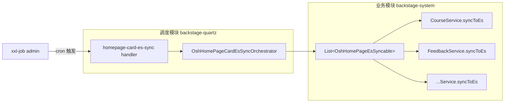

# 首页卡片 ES + MySQL 兜底统一改造方案（xxl-job 版）

> 在 [home_page_card_es_refactor_design.md](./home_page_card_es_refactor_design.md) 的基础上，把"Spring `@Scheduled` 定时任务"替换为 xxl-job 集群调度。
> 参考实现：`backstage-quartz/src/main/java/com/backstage/quartz/task/HomepageAnnouncementRefreshTask.java`。

---

## 1. 背景与目标

### 1.0 不可触碰的约束（最高优先级）
- **不得修改任何首页模块的 MySQL 查询逻辑**，包括：
  - `OshHomePageXxxMapper.java` 接口与对应 `OshHomePageXxxMapper.xml` 的所有 SQL（候选过滤、排序、热度公式、`limit` 等）
  - 现有 `OshHomePageXxxServiceImpl` 中的标签/链接/封面 OSS 临时地址等"补全逻辑"
  - 任何 MySQL 字段名、参数顺序、返回结构
- 本次改造**只在 MySQL 之外**新增一条"ES 优先 + 失败兜底 MySQL"的读路径，以及把 MySQL 已有结果作为同步源写入 ES 的逻辑。
- 抽象基类调用 MySQL 必须通过原 `Service` 已暴露的现成方法（例如 `getHotCoursesFromMysql(int)` / `getHotXxx(int)`），不得旁路调用 `Mapper`。
- 任何引入"为 ES 同步而修改 SQL / 增字段 / 改排序"的需求，需要拒绝并在 PR 中明确说明。

### 1.1 为什么从 `@Scheduled` 切换到 xxl-job
- **多机重复执行**：`@Scheduled` 是 JVM 内定时器，N 个实例 = N 次执行。会出现"同一时刻 N 次 deleteAll + bulkUpsert"，期间 ES 短暂为空。
- **失败不可观测**：原生 `@Scheduled` 不带失败重试、未告警入口，需要自建监控。
- **运维不可控**：cron 写死在代码里，调整必须发版。

### 1.2 改用 xxl-job 后能拿到什么
| 能力 | 说明 |
|---|---|
| 集群唯一执行 | xxl-job 调度中心保证同一时刻只下发到一台执行器，天然解决"多机重复执行"。 |
| 失败自动重试 | 执行器返回失败 → 调度中心按配置重试 N 次。 |
| 失败告警 | xxl-job admin 自带邮件 / 钉钉等告警通道。 |
| 调度可控 | cron / 路由策略 / 阻塞策略 / 失败处理策略，全部 admin 配置，不发版。 |
| 手动触发 | 应急时可在 admin 一键执行一次。 |
| 日志可视化 | 每次执行的 `XxlJobHelper.log(...)` 在 admin 可查。 |

### 1.3 适用范围
首页模块所有"卡片型只读列表"接口：热门课程、用户反馈、热门工具、热门项目、热门书籍、热门考试、热门拼团、热门秒杀、热门信息差、热门 QA、热门站点。

---

## 2. 总体架构



要点：
- **调度入口**：放在 `backstage-quartz` 模块，与已有的 `HomepageAnnouncementRefreshTask` 同目录、同写法。
- **业务编排**：放在 `backstage-system` 模块的 `OshHomePageCardEsSyncOrchestrator`，由 Spring 自动注入所有 `OshHomePageEsSyncable` 实现。
- **业务实现**：每张卡片的 `Service` 仍然继承上一版的抽象基类 `AbstractOshHomePageEsCardService<D, V>`，保持开闭原则。

---

## 3. 组件清单（与原版差异）

| 组件 | 位置 | 是否新增 | 与上一版差异 |
|---|---|---|---|
| `OshHomePageEsSyncable`（标记接口） | `backstage-system / service.homepage.es` | 同前 | 不变 |
| `AbstractOshHomePageEsCardService<D,V>`（模板基类） | `backstage-system / service.homepage.es` | 同前 | 不变 |
| `OshHomePageCardEsSyncOrchestrator`（业务编排） | `backstage-system / service.homepage.es` | 新增 | 把原 `@Scheduled` 任务的"遍历调用 + 异常聚合"职责挪到这里 |
| `OshHomePageCardEsSyncTask`（xxl-job handler） | `backstage-quartz / quartz.task` | 新增 | **替换** 原 `OshHomePageHotCourseSyncTask` 等 `@Scheduled` 任务 |
| 各 `OshHomePageXxxServiceImpl` | `backstage-system / service.impl.homepage` | 改造 | 继承基类即可 |

---

## 4. 关键代码

### 4.1 标记接口 `OshHomePageEsSyncable`

```java
package com.backstage.system.service.homepage.es;

public interface OshHomePageEsSyncable {
    /** 卡片唯一标识，用于日志与排查，例如 "course" / "feedback" */
    String cardType();

    /** 全量同步当前卡片，返回写入文档数 */
    int syncToEs();

    /** 启动时索引检查（可空实现） */
    default void ensureIndexReady() {}
}
```

### 4.2 抽象基类 `AbstractOshHomePageEsCardService<D, V>`

> 与上一版同；保留 `getCards(int)` 模板入口、`syncToEs()` 模板同步，子类只填具体 ES/MySQL/转换逻辑。

```java
public abstract class AbstractOshHomePageEsCardService<D, V> implements OshHomePageEsSyncable {

    protected static final Logger log =
            LoggerFactory.getLogger(AbstractOshHomePageEsCardService.class);

    @Autowired
    protected SearchEsProperties searchEsProperties;

    public final List<V> getCards(int requestedLimit) {
        int eff = normalizeLimit(requestedLimit);
        if (eff <= 0) return Collections.emptyList();
        if (searchEsProperties.isEnabled()) {
            try {
                List<D> docs = queryFromEs(eff);
                if (docs != null && !docs.isEmpty()) return toVos(docs);
                log.warn("[homepage-{}] es empty, fallback mysql, limit={}", cardType(), eff);
            } catch (Exception e) {
                log.warn("[homepage-{}] es failed, fallback mysql, limit={}", cardType(), eff, e);
            }
        }
        return queryFromMysql(eff);
    }

    @Override
    public final int syncToEs() {
        LocalDateTime syncTime = LocalDateTime.now();
        List<V> vos = queryFromMysql(syncLimit());
        List<D> docs = toDocs(vos, syncTime);
        try {
            deleteAll();
            return bulkUpsert(docs);
        } catch (Exception e) {
            log.error("[homepage-{}] sync failed, startTime={}", cardType(), syncTime, e);
            throw new RuntimeException("sync homepage " + cardType() + " failed", e);
        }
    }

    protected abstract List<D> queryFromEs(int limit) throws IOException;
    protected abstract List<V> queryFromMysql(int limit);
    protected abstract List<V> toVos(List<D> docs);
    protected abstract List<D> toDocs(List<V> vos, LocalDateTime syncTime);
    protected abstract void deleteAll() throws IOException;
    protected abstract int bulkUpsert(List<D> docs) throws IOException;

    protected int maxLimit() { return 5; }
    protected int syncLimit() { return maxLimit(); }

    private int normalizeLimit(int n) {
        if (n <= 0) return 0;
        return Math.min(n, maxLimit());
    }
}
```

### 4.3 业务编排 `OshHomePageCardEsSyncOrchestrator`

```java
package com.backstage.system.service.homepage.es;

import com.backstage.system.config.properties.SearchEsProperties;
import org.slf4j.Logger;
import org.slf4j.LoggerFactory;
import org.springframework.beans.factory.annotation.Autowired;
import org.springframework.stereotype.Component;

import java.util.HashMap;
import java.util.List;
import java.util.Map;

/**
 * 首页卡片 ES 同步编排器。
 * 由 xxl-job 任务调用；按 cardType 维度统计成功/失败，但不抛单卡失败，保证 batch 不被单卡阻断。
 */
@Component
public class OshHomePageCardEsSyncOrchestrator {

    private static final Logger log =
            LoggerFactory.getLogger(OshHomePageCardEsSyncOrchestrator.class);

    @Autowired
    private List<OshHomePageEsSyncable> syncables;

    @Autowired
    private SearchEsProperties searchEsProperties;

    public Map<String, Integer> syncAll() {
        Map<String, Integer> result = new HashMap<>();
        if (!searchEsProperties.isEnabled()) {
            log.warn("[homepage-sync] es disabled, skip all");
            return result;
        }
        for (OshHomePageEsSyncable s : syncables) {
            try {
                int n = s.syncToEs();
                result.put(s.cardType(), n);
                log.info("[homepage-sync] {} done, written={}", s.cardType(), n);
            } catch (Exception e) {
                result.put(s.cardType(), -1);
                log.error("[homepage-sync] {} failed", s.cardType(), e);
            }
        }
        return result;
    }

    public int syncOne(String cardType) {
        if (!searchEsProperties.isEnabled()) {
            log.warn("[homepage-sync] es disabled, skip {}", cardType);
            return 0;
        }
        for (OshHomePageEsSyncable s : syncables) {
            if (s.cardType().equalsIgnoreCase(cardType)) {
                return s.syncToEs();
            }
        }
        throw new IllegalArgumentException("unknown cardType: " + cardType);
    }
}
```

### 4.4 xxl-job 任务 `OshHomePageCardEsSyncTask`

> 完全对齐项目里现有 `HomepageAnnouncementRefreshTask` 的写法。

```java
package com.backstage.quartz.task;

import com.backstage.system.service.homepage.es.OshHomePageCardEsSyncOrchestrator;
import com.xxl.job.core.context.XxlJobHelper;
import com.xxl.job.core.handler.annotation.XxlJob;
import org.slf4j.Logger;
import org.slf4j.LoggerFactory;
import org.springframework.stereotype.Component;

import javax.annotation.Resource;
import java.util.Map;

/**
 * 首页卡片 ES 同步任务（xxl-job）。
 * handler 名称：homepage-card-es-sync         全量同步所有卡片
 * handler 名称：homepage-card-es-sync-one     按 cardType 同步单卡（应急用）
 * 推荐 cron：0 0/5 * * * ?
 */
@Component
public class OshHomePageCardEsSyncTask {

    private static final Logger log = LoggerFactory.getLogger(OshHomePageCardEsSyncTask.class);

    @Resource
    private OshHomePageCardEsSyncOrchestrator orchestrator;

    @XxlJob("homepage-card-es-sync")
    public void syncAll() {
        XxlJobHelper.log("首页卡片 ES 同步任务开始");
        log.info("[homepage-card-es-sync] xxl-job start");
        try {
            Map<String, Integer> result = orchestrator.syncAll();
            result.forEach((card, n) ->
                    XxlJobHelper.log("card={0}, written={1}", card, n));
            log.info("[homepage-card-es-sync] xxl-job finished, result={}", result);
            // 只要不抛异常，xxl-job admin 会标记成功；
            // 若希望 admin 标失败，可在出现 -1 时主动调用 XxlJobHelper.handleFail();
        } catch (Exception ex) {
            XxlJobHelper.log("首页卡片 ES 同步任务失败: {0}", ex.getMessage());
            log.error("[homepage-card-es-sync] xxl-job failed, error={}", ex.getMessage(), ex);
            throw ex;
        }
    }

    /**
     * 单卡同步，xxl-job 执行参数填 cardType，例如 "course" / "feedback"。
     * 应急或灰度首次接入时使用。
     */
    @XxlJob("homepage-card-es-sync-one")
    public void syncOne() {
        String cardType = XxlJobHelper.getJobParam();
        XxlJobHelper.log("首页卡片 ES 同步任务（单卡）开始, cardType={0}", cardType);
        log.info("[homepage-card-es-sync-one] xxl-job start, cardType={}", cardType);
        try {
            int n = orchestrator.syncOne(cardType);
            XxlJobHelper.log("单卡 {0} 同步完成, written={1}", cardType, n);
            log.info("[homepage-card-es-sync-one] done, cardType={}, written={}", cardType, n);
        } catch (Exception ex) {
            XxlJobHelper.log("单卡 {0} 同步失败: {1}", cardType, ex.getMessage());
            log.error("[homepage-card-es-sync-one] failed, cardType={}, error={}", cardType, ex.getMessage(), ex);
            throw ex;
        }
    }
}
```

### 4.5 启动时索引初始化（不依赖 xxl-job）

xxl-job 是用于"周期触发"，**不应**承担"首次部署的索引创建"。索引建好这件事仍放在业务模块自身的 `InitializingBean` 钩子里完成（每个卡片 `Service` 的 `ensureIndexReady()`）。

```java
@Component
public class OshHomePageEsIndexInitializer implements InitializingBean {

    private static final Logger log = LoggerFactory.getLogger(OshHomePageEsIndexInitializer.class);

    @Autowired
    private List<OshHomePageEsSyncable> syncables;

    @Autowired
    private SearchEsProperties searchEsProperties;

    @Override
    public void afterPropertiesSet() {
        if (!searchEsProperties.isEnabled()) return;
        for (OshHomePageEsSyncable s : syncables) {
            try {
                s.ensureIndexReady();
            } catch (Exception e) {
                log.warn("[homepage-sync] {} init failed", s.cardType(), e);
            }
        }
    }
}
```

> 这样即便 xxl-job 暂时未注册任务，应用启动也能保证索引存在并做一次首同步，配合 controller 的 MySQL 兜底，用户始终能拿到数据。

---

## 5. xxl-job admin 上的任务配置

| 字段 | 推荐值 | 说明 |
|---|---|---|
| 任务描述 | 首页卡片 ES 同步（全量） | |
| 执行器 | 与现有任务相同（如 `osh-executor`） | 由 `xxl.job.executor.appname` 决定 |
| JobHandler | `homepage-card-es-sync` | 与 `@XxlJob` 注解值一致 |
| 任务参数 | （留空） | |
| Cron | `0 0/5 * * * ?` | 每 5 分钟一次 |
| 路由策略 | `FIRST` 或 `ROUND` | 因为执行器侧本身是幂等全量覆盖，集群里随机一台都行 |
| 阻塞处理策略 | `DISCARD_LATER` | 防止上一轮还没跑完又触发；丢弃后等下一轮 |
| 调度过期策略 | `IGNORE` | 错过窗口直接放弃，下一轮补 |
| 任务超时 | 60 秒 | 远高于实际耗时即可 |
| 失败重试次数 | 2 | 网络抖动友好；ES 失败 → 旧数据保留 |
| 报警邮件 / 通知 | 配置接收人 | |

应急任务 `homepage-card-es-sync-one`：
- 不挂 cron，仅手动触发；
- "任务参数" 处填卡片名（例如 `feedback`）。

---

## 6. 失败与容灾

### 6.1 数据丢失分析
- **MySQL 是 Source of Truth**：ES 是首页只读视图，丢了不影响业务正确性。
- **同步失败 → 旧 ES 数据保留**：模板内是 `deleteAll → bulkUpsert`，但失败的位置都在抛异常之前/之中，ES 中**已写入的旧文档**只有在 bulkUpsert 成功后才会被"替换 + 覆盖"。极端情况：`deleteAll` 成功、`bulkUpsert` 失败 → 索引短暂为空 → 接口自动 fallback MySQL。
- **接口兜底**：`AbstractOshHomePageEsCardService#getCards` 内置 try/catch + 空结果 fallback，任何 ES 异常前端无感。

### 6.2 进阶：消除"清空-写入"窗口（可选 v2）
若需要"任何瞬间 ES 都不为空"，把 deleteAll + bulkUpsert 升级为 **别名 + 双索引**：

1. 真实索引：`homepage_hot_course_v1`、`homepage_hot_course_v2`
2. 别名：`homepage_hot_course` 当前指向其中一个。
3. 同步逻辑：写入备用索引 → 切 alias → 删除旧索引。

> v1 方案不实现，保留扩展点。

### 6.3 告警建议
1. xxl-job admin 配置 **失败告警**（邮件 / 钉钉）。
2. 监控 ES 中 `syncTime` 字段的最大值，超过 `cron 间隔 * 2` 时 → 告警。
3. 指标暴露（micrometer）：
   - `homepage_card_sync_total{card="course",result="success|fail"}`
   - `homepage_card_sync_duration_seconds{card="course"}`

---

## 7. 改造步骤

### 7.1 骨架准备（一次性）
1. 新建 `backstage-system / service.homepage.es` 包，放入：
   - `OshHomePageEsSyncable`
   - `AbstractOshHomePageEsCardService<D, V>`
   - `OshHomePageCardEsSyncOrchestrator`
   - `OshHomePageEsIndexInitializer`
2. `backstage-quartz / task` 下新增 `OshHomePageCardEsSyncTask`（参照 `HomepageAnnouncementRefreshTask`）。
3. xxl-job admin 注册 `homepage-card-es-sync` 任务并配置 cron / 报警。

### 7.2 接入热门课程（迁移现有逻辑）
1. 让 `OshHomePageCourseServiceImpl` 继承 `AbstractOshHomePageEsCardService<OshHomePageHotCourseEsDocument, HotCourseVO>`。
2. **不修改任何 SQL**：`queryFromMysql(int)` 直接转调现有的 `getHotCoursesFromMysql(int)`；`OshHomePageCourseMapper.java` / `OshHomePageCourseMapper.xml` 保持原样。
3. 把现有的 limit 规范化、ES fallback、syncHotCoursesToEs 等代码迁移到模板方法实现里。
4. **删除** `OshHomePageHotCourseSyncTask`（原 `@Scheduled` 类）。
5. 在 xxl-job admin 启用该任务后，做一次手动触发，确认 admin 日志、ES 索引文档数都 OK。

### 7.3 接入其他卡片
按以下顺序逐个接入：feedback → tool → openProject → book → exam → group → seckill → infoGap → qa → website。

每张卡片 4 步：
1. 新建 `OshHomePageHotXxxEsDocument`
2. 新建 `OshHomePageHotXxxEsMapper`（复刻 Course 版本，改 `INDEX_NAME` / `MAPPING_RESOURCE`）
3. 新建 `resources/es/homepage_hot_xxx_index.json`
4. `OshHomePageXxxServiceImpl` 继承基类，实现 5 个抽象方法 + `ensureIndexReady`
   - **`queryFromMysql(int)` 必须复用 Service 内已有的 MySQL 查询方法**（含 SQL、标签/链接/封面补全等），不得改写任何 SQL 或新建 SQL。
   - 若该卡片当前没有可复用的"对外 MySQL 查询方法"，先在原 Service 内**新增一个不改 SQL 的、纯转发现有 Mapper 的方法**，再让基类调用它。

> 完全无需改 Controller、VO、xxl-job handler，自动加入下一次集群调度。

### 7.4 验收
- 接口契约：URL、入参、响应结构、字段顺序与原版一致。
- xxl-job admin：任务存在、cron 正确、最近 N 次执行成功率 100%。
- ES：每张卡片索引存在、文档数等于 sourceLimit。
- 降级演练：临时 `search.es.enabled=false` → 接口仍正常 → 改回。
- 失败演练：kill 一台执行器 → 调度中心自动落到下一台。

---

## 8. 配置示例

```yaml
# application.yml
search:
  es:
    enabled: true
    fallback-timeout-millis: 800

homepage:
  card:
    fixed-size: 5

# xxl-job 沿用已有配置，无需新增
xxl:
  job:
    admin:
      addresses: http://xxl-job-admin:8080/xxl-job-admin
    executor:
      appname: osh-executor
      ip:
      port: 9999
      logpath: ./logs/xxl-job/jobhandler
      logretentiondays: 30
    accessToken: <已有 token>
```

---

## 9. 与上一版（@Scheduled 版）的对照

| 维度 | 上一版 `@Scheduled` | 本版 xxl-job |
|---|---|---|
| 多机并发 | N 实例 = N 次执行 | 集群唯一执行 |
| 失败重试 | 无 | admin 配置 N 次 |
| 失败告警 | 无 | admin 内置邮件 / 钉钉 |
| cron 调整 | 改代码发版 | admin 改 cron，秒生效 |
| 手动触发 | 无 | admin 一键执行 |
| 应急单卡补偿 | 无 | `homepage-card-es-sync-one` + 参数 |
| 业务侧改动 | `OshHomePageCardEsSyncTask` 注解 `@Scheduled` | 注解 `@XxlJob`，逻辑下沉到 Orchestrator |
| 兜底链路 | 不变（接口内置 MySQL fallback） | 不变 |

---

## 10. 落地清单

- [ ] `OshHomePageEsSyncable` 接口
- [ ] `AbstractOshHomePageEsCardService<D, V>` 基类
- [ ] `OshHomePageCardEsSyncOrchestrator` 编排器
- [ ] `OshHomePageEsIndexInitializer` 启动初始化
- [ ] `OshHomePageCardEsSyncTask` xxl-job 入口（`homepage-card-es-sync` / `homepage-card-es-sync-one`）
- [ ] 删除 `OshHomePageHotCourseSyncTask`（`@Scheduled` 老类）
- [ ] xxl-job admin 注册并验证两个任务
- [ ] 热门课程接入基类（**不改 SQL**）
- [ ] 其余 10 张卡片按 4 步走清单接入（**不改 SQL**）
- [ ] 关键指标接入监控告警

## 11. PR 自检清单（评审硬卡）

- [ ] 未新增或修改 `osh-backend/backstage-system/src/main/resources/mapper/homepage/*.xml`
- [ ] 未修改 `osh-backend/backstage-system/src/main/java/com/backstage/system/mapper/homepage/*Mapper.java` 中已有方法签名
- [ ] 未修改 `OshHomePageXxxServiceImpl` 中已有的 MySQL 查询 / 标签 / 链接 / 封面补全方法体
- [ ] 仅通过现成方法或新增"纯转发"方法访问 MySQL
- [ ] Controller、VO、URL、入参、响应结构无变化
- [ ] `application.yml` 中除 `search.es.*` / `homepage.card.*` 外无其他修改

