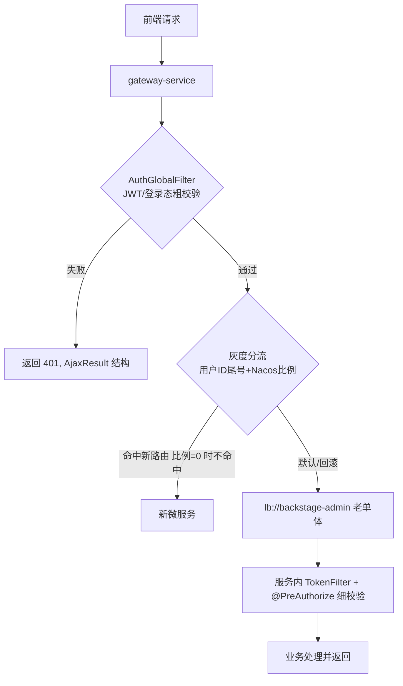

# Design: add-gateway-service

## 方案概览

新建独立 Maven 模块/仓库 `gateway-service`，基于 Spring Cloud Gateway（WebFlux 响应式）实现统一入口。Phase 0 配置为透明反向代理：默认路由把所有 `/**` 转发到老单体 backstage-admin（经 Nacos 服务发现 lb://backstage-admin）。鉴权改造为双层：网关侧新增 AuthGlobalFilter 承担 JWT 有效性 + 登录态存在性粗校验（复用 common 的 JWT 工具与 LoginUser 缓存 key），校验通过则把用户上下文透传到下游请求头；服务内保留 TokenFilter 与 @PreAuthorize 细校验作为兜底。路由与灰度规则由 Nacos 动态下发，支持按路径前缀路由与按用户 ID 尾号灰度分流。限流用 Sentinel 网关流控（或 RequestRateLimiter + Redis），统一异常/跨域由网关全局处理器负责，异常响应结构对齐单体 AjaxResult。

## 现状分析

- 相关模块：backstage-framework（TokenFilter、SecurityConfig、JWT 过滤器）、backstage-common（JWT 工具、Redis 工具、LoginUser、AjaxResult、常量）。
- 相关类/接口：TokenFilter（登录态校验）、JwtUtils（token 解析）、LoginUser（缓存对象）、AjaxResult/TableDataInfo（响应封装）、@PreAuthorize（权限注解）。
- 当前数据结构：登录态存 Redis（LoginUser），key 格式在 common 中定义。
- 当前配置：前端直连单体；无独立网关；Nacos 已用于注册与配置。

## 详细设计

### 接口设计（网关路由契约）

| Method | Path | 变化 | 兼容策略 |
|---|---|---|---|
| ALL | /** | 新增网关入口，Phase 0 透明转发到 lb://backstage-admin | URL/参数/响应结构不变，前端零改造 |
| ALL | /pc/** | 预留按前缀路由到未来 content/course 等服务 | Phase 0 仍转发单体；split-* 阶段改路由目标 |
| ALL | /api/** | 预留 C 端前缀路由 | 同上 |

- 灰度分流：AuthGlobalFilter 解析用户 ID，按尾号 + Nacos 配置的比例决定命中"新路由"还是"老单体路由"；Phase 0 灰度比例默认 0（全部走单体）。
- 鉴权透传：网关校验通过后，向下游注入用户上下文请求头（如 X-User-Id、X-User-Key），下游服务据此还原 LoginUser；内部头禁止外部伪造（网关入口清洗）。

### 数据设计

| 表/索引/缓存 | 变化 | 迁移方式 | 回滚方式 |
|---|---|---|---|
| Redis（LoginUser） | 无变化，仅新增网关侧只读校验 | 复用同一 key 格式（冻结） | 网关下线，单体继续读同一 key |
| MySQL | 无 | 不涉及 | 不涉及 |
| Nacos 配置 | 新增 gateway 路由/灰度/限流配置 | 动态下发，版本化 | Nacos 版本历史回退 |

### 业务流程

### 中间件影响

- Redis：网关只读校验 LoginUser，key 格式冻结；不新增写。
- Kafka：无。
- Elasticsearch：无。
- Nacos：网关服务注册 + 动态路由/灰度/限流配置；地址禁止带 http:// 前缀（历史坑）。
- R2/S3：无（签名仍由业务/platform 承担）。

## 兼容性

- 老接口是否保留：是，Phase 0 全量透明转发到老单体。
- 老数据是否可读：是，网关不落库不改缓存。
- 前端是否需要同步：不需要（如需将 baseURL 指向网关，由 LB/DNS 层切换，前端代码不改）。
- 灰度期间新旧版本是否兼容：兼容。网关与单体双层鉴权，LoginUser key 与 JWT 解析一致；灰度比例 0 时行为等价于纯代理。

## 测试计划

- 单元测试：AuthGlobalFilter 的 JWT 解析、灰度命中判定、内部头清洗逻辑。
- 集成测试：网关 + 单体端到端，覆盖登录、鉴权失败、透传下游。
- 接口 smoke：经网关访问登录、课程详情、下单、支付回调，响应与直连单体逐字段对比一致。
- 回归范围：C 端/B 端权限不混用（历史教训）；无效/过期 token 拦截；限流触发；CORS 预检。

## 发布与回滚

- 发布步骤：部署 gateway-service → 注册 Nacos → LB/DNS 将流量指向网关（灰度比例 0，纯代理）→ smoke 对比 → 观察。
- 验证命令：`curl` 经网关与直连单体分别请求核心接口，diff 响应；健康检查 /actuator/health。
- 回滚步骤：路由级回滚——LB/DNS 指回单体直连，或网关下线；因无数据变更，回滚无损、秒级生效。
