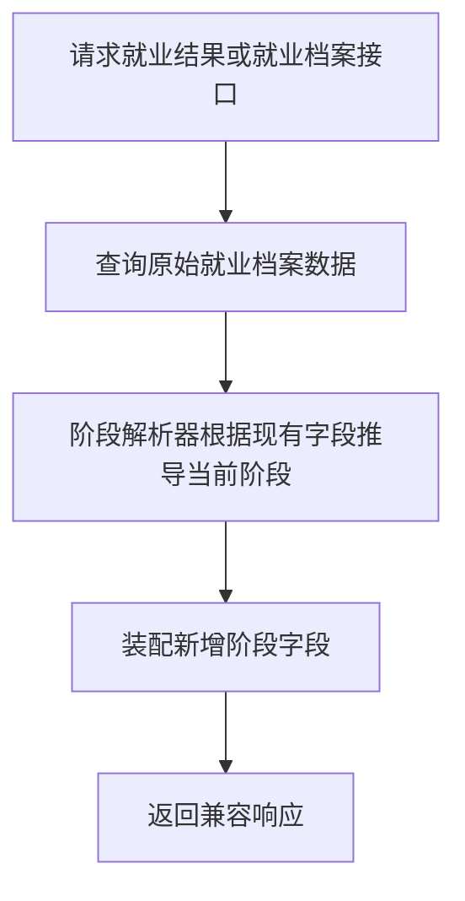

# Design: add-internal-member-progress-stage

## 方案概览

新增内部付费用户阶段枚举 `InternalMemberProgressStageEnum`，由后端基于就业档案里的 `jobStatus`、`resumeDeliveryCount`、`interviewCompanyCount`、`pendingInterviewCount`、`interviewStatus`、`interviewResult`、`entryTime` 等字段统一推导当前阶段。  
在原有返回 VO 中追加阶段字段，由 service 层做装配，避免把兼容逻辑散落到 controller 或 SQL 中。

## 现状分析

- 相关模块：
  - `com.backstage.system.controller.internalmember`
  - `com.backstage.system.service.internalmember`
  - `com.backstage.system.mapper.internalmember`
- 相关接口：
  - `GET /pc/admin/internal-member/outcome/page`
  - `GET /pc/admin/internal-member/{userId}/employment-profile`
- 当前数据结构：
  - `osh_internal_member_employment_profile` 已记录就业状态、简历投递、面试状态、面试结果、入职时间等字段。
- 当前问题：
  - `jobStatus` 只有三段粗状态。
  - 前端若想展示阶段进度，需要二次拼接多字段规则。

## 详细设计

### 接口设计

| Method | Path | 变化 | 兼容策略 |
|---|---|---|---|
| GET | `/pc/admin/internal-member/outcome/page` | 追加阶段字段 | 保留原字段与分页结构 |
| GET | `/pc/admin/internal-member/{userId}/employment-profile` | 追加阶段字段 | 保留原字段与结构 |

新增返回字段：

- `progressStageCode`: 阶段枚举编码
- `progressStageName`: 阶段名称
- `progressStageOrder`: 阶段序号，从 1 开始
- `progressStageTotal`: 总阶段数，当前固定为 6

### 阶段枚举

统一定义 6 个阶段：

1. `separated`：待求职/离职
2. `preparing`：求职准备
3. `delivering`：投递中
4. `interviewing`：面试中
5. `offer_pending`：Offer/待入职
6. `onboarded`：已入职

### 阶段推导规则

按优先级从高到低判断：

1. 若 `jobStatus = 2` 或 `interviewResult = onboarded` 或 `entryTime` 非空，则为 `onboarded`
2. 若 `interviewResult = offer_sent`，则为 `offer_pending`
3. 若存在 `interviewCompanyCount > 0`、`pendingInterviewCount > 0`、`completedInterviewCount > 0`、`interviewRoundCount > 0`，或 `interviewStatus` 属于面试相关状态，则为 `interviewing`
4. 若 `resumeDeliveryCount > 0`，则为 `delivering`
5. 若 `jobStatus = 1`，则为 `preparing`
6. 其他情况为 `separated`

这样可以保证：

- 兼容旧数据，只要任一关键字段存在即可提升到更细阶段。
- 不要求数据库迁移。
- 后续若要把阶段落库，也可以沿用同一枚举编码。

### 数据设计

| 表/索引/缓存 | 变化 | 迁移方式 | 回滚方式 |
|---|---|---|---|
| `osh_internal_member_employment_profile` | 无表结构变化 | 无需迁移 | 无需回滚 |

### 业务流程

### 中间件影响

- Redis：无
- Kafka：无
- Elasticsearch：无
- Nacos：无
- R2/S3：无

## 兼容性

- 老接口是否保留：保留
- 老数据是否可读：可读
- 前端是否需要同步：旧前端不需要，新前端可选择使用新字段
- 灰度期间新旧版本是否兼容：兼容

## 测试计划

- 单元测试：阶段解析器不同输入的阶段结果
- 集成测试：controller 返回新增阶段字段且不影响原响应结构
- 接口 smoke：内部付费用户就业结果列表与就业档案详情
- 回归范围：付费用户后台就业模块

## 发布与回滚

- 发布步骤：按常规后端发布
- 验证命令：执行对应测试
- 回滚步骤：回滚本次代码改动即可
