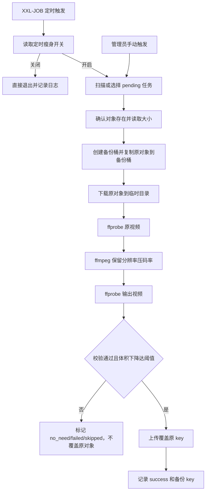

# Design: add-object-storage-slimmer

## 方案概览

后端新增对象存储瘦身服务，扫描 R2 对象并写入任务表。视频任务进入瘦身流程时，先把原对象复制到备份桶，再下载到临时目录，使用 `ffprobe` 获取媒体信息，使用原生 `ffmpeg` 以 H.264 + AAC 执行转码，完成后再次 `ffprobe` 校验输出文件。只有校验通过且体积下降达到当前模式阈值时，才上传覆盖原 key。XXL-JOB 调用同一服务，Nuxt 管理页通过 `/pc/admin/object-slim/**` 查看和操作任务。

## 现状分析

- 相关模块：
  - `backstage-system`：R2 工具、课程视频上传、管理接口。
  - `backstage-quartz`：XXL-JOB handler。
  - `osh-frontend`：Nuxt 主站管理页面。
- 相关类/接口：
  - `OssProperties`：R2 access key、secret key、endpoint、bucket、public domain。
  - `OssUtil`：创建 S3 client、签名 URL、删除对象。
  - `CourseManageServiceImpl`：课程视频上传使用相对 key。
  - `XxlJobConfig`：XXL-JOB executor 配置。
- 当前数据结构：
  - `osh_course_section.media_url` 存储课程视频对象 key 或历史 URL。
  - `osh_oss_operation_log` 不完整覆盖课程视频直传记录。
- 当前配置：
  - QA Nacos `osh-backend-test.yaml` 中 R2 bucket 需要从 `osh` 改为 `osh-qa`。

## 详细设计

### 接口设计

| Method | Path | 变化 | 兼容策略 |
|---|---|---|---|
| GET | `/pc/admin/object-slim/config` | 查询当前桶、备份桶、开关、ffmpeg 可用性和可选瘦身模式 | 新增接口 |
| POST | `/pc/admin/object-slim/config/enabled` | 启停定时瘦身开关 | 新增接口，关闭时 job 直接退出 |
| GET | `/pc/admin/object-slim/overview` | 查询统计信息 | 新增接口 |
| POST | `/pc/admin/object-slim/page` | 分页查询任务 | 新增接口 |
| POST | `/pc/admin/object-slim/scan` | 手动扫描 R2 对象 | 新增接口 |
| POST | `/pc/admin/object-slim/slim` | 手动触发单个或批量瘦身 | 新增接口 |
| POST | `/pc/admin/object-slim/retry` | 重试失败/跳过任务 | 新增接口 |
| POST | `/pc/admin/object-slim/rollback` | 用备份覆盖回原 key | 新增接口 |
| POST | `/pc/admin/object-slim/backup/delete` | 管理员确认后删除备份对象 | 新增接口，不自动调用 |
| GET | `/pc/admin/object-slim/preview-url` | 生成原对象临时播放 URL | 新增接口 |

### 数据设计

新增 `osh_object_slim_task`：

| 字段 | 说明 |
|---|---|
| `bucket` / `object_key` | 原始对象定位，唯一索引 |
| `backup_bucket` / `backup_key` | 备份对象定位 |
| `file_type` / `source_type` / `source_id` | 文件类型和来源 |
| `original_size` / `slim_size` / `saved_size` / `saved_ratio` | 体积与节省 |
| `slim_mode` | 本次实际使用的瘦身模式 |
| `status` | `pending/running/success/failed/skipped/no_need/rolled_back/backup_deleted` |
| `codec_before/after`、`resolution_before/after`、`duration_before/after`、`bitrate_before/after` | 媒体信息 |
| `attempt_count` / `last_error` / `last_run_time` | 执行记录 |

### 业务流程

### 瘦身策略

- 默认处理扩展名：`mp4/mov/m4v/webm/mkv/avi`。
- 输出 MP4：`libx264`、`pix_fmt yuv420p`、`movflags +faststart`。
- 支持多种瘦身模式：`quality` 高画质、`balanced` 均衡默认、`storage_saver` 节省优先、`low_cost` 极省空间。
- `quality` 和 `balanced` 不降分辨率；`storage_saver` 最高 1080p；`low_cost` 最高 720p。
- 不同模式有独立 CRF、preset、音频码率和最小节省比例。
- 默认模式为 `balanced`：`preset veryfast`、`crf 23`、`aac 128k`，不降分辨率，最小节省比例 10%。
- 默认时长差不超过 2 秒。
- 每次执行默认 limit 5，单进程串行处理，避免压垮测试服务器。
- XXL-JOB 参数中 `mode` 继续表示执行方式，`slimMode` 表示瘦身模式，例如 `{"mode":"scan-and-slim","slimMode":"storage_saver","limit":5}`。

### 中间件影响

- Redis：仅复用 `sys_config` 缓存保存启停开关。
- Kafka：无影响。
- Elasticsearch：无影响。
- Nacos：QA R2 bucket 改为 `osh-qa`；XXL-JOB 配置只读取不修改。
- R2/S3：新增 list/head/copy/put/delete bucket/object 操作。

## 兼容性

- 老接口保留：是。
- 老数据可读：是，课程仍读原 `media_url`。
- 前端需要同步：是，新增 Nuxt 管理页。
- 灰度兼容：定时瘦身开关默认关闭；上线后可先手动扫描，再少量手动瘦身。

## 测试计划

- 单元测试：
  - 参数解析、任务状态流转、节省比例判断、跳过不支持文件。
- 集成测试：
  - 使用 mock S3/命令执行器验证备份后覆盖流程。
- 接口 smoke：
  - config、overview、page、scan、slim、preview-url。
- 回归范围：
  - 课程视频上传和播放临时 URL 生成不改变。
  - 旧后台不受影响。

## 发布与回滚

- 发布步骤：
  1. 执行新增 SQL。
  2. 确认 QA Nacos bucket 为 `osh-qa`。
  3. 确认部署机器存在 `ffmpeg` 和 `ffprobe`。
  4. 在 XXL-JOB Admin 新增或启用 handler `osh-object-storage-slimmer`。
  5. 后台先关闭定时开关，手动扫描后小批量测试。
- 验证命令：
  - `mvn -pl backstage-system,backstage-quartz -am test`
  - `npm run generate`
- 回滚步骤：
  - 关闭定时瘦身开关。
  - 如对象异常，使用后台回滚或手动从备份桶复制回原 key。
  - 回滚代码不需要删除任务表。
