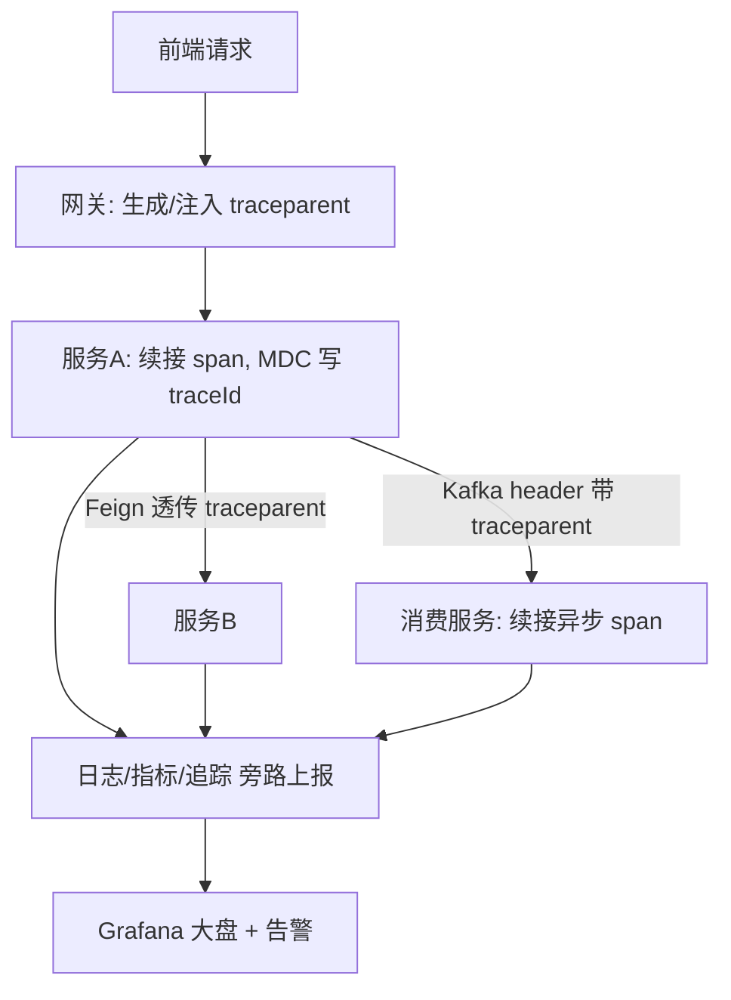

# Design: add-observability-stack

## 方案概览

建设"三支柱可观测性 + 四件套治理"。追踪采用 Micrometer Tracing + OpenTelemetry（新服务 SB3 原生）→ Jaeger/Tempo，老单体（SB2.7）用 Sleuth 兼容层，统一以 W3C traceparent 传播，网关负责注入、双方透传，Kafka 消息头携带 traceparent 保证异步链路连续（覆盖 Outbox 提交后发布与 GROUP 域 GroupEventPublisher 直发两条路径）。指标用 Micrometer → Prometheus → Grafana；日志用 Logback + MDC(traceId, service) → ELK/Loki，沿用现有脱敏规范。治理用 Sentinel（限流/熔断）+ OpenFeign 超时/重试/fallback 配置。告警用 Grafana Alerting 接入现有邮件链路。产出统一接入模板供 split-* 复用。

## 现状分析

- 相关模块：backstage-common（日志工具、脱敏）、backstage-framework（Kafka 消费者、线程池、配置）、全部业务服务。
- 相关类/接口：OutboxEventServiceImpl（publishAfterCommit 事务后发布，course/tool/seckill 三类聚合）、GroupEventPublisher（GROUP 域事务后直发 Kafka，不走 Outbox）、FeedbackStatusMailNotifier（邮件通知链路）、现有 Logback 配置（sys-error/sys-info/sys-oshUser 分文件）。
- 当前数据结构：无（可观测性不落业务库）；日志/指标/追踪存于各自后端存储。
- 当前配置：Logback 配置在 common/framework；无统一 traceId 透传；无 Prometheus 指标暴露。

## 详细设计

### 三支柱设计

| 支柱 | 选型 | 落地要点 |
|---|---|---|
| 追踪 Tracing | Micrometer Tracing + OTel → Jaeger/Tempo（新服务）；Sleuth（老单体过渡） | W3C traceparent 统一传播；网关注入；Feign/RestTemplate 拦截器透传；Kafka 生产者写 header、消费者读 header 续接 span；线程池/异步需包装 TaskDecorator 传递 MDC 与 trace 上下文 |
| 指标 Metrics | Micrometer + Prometheus + Grafana | 每服务暴露 /actuator/prometheus；核心大盘：QPS、P99、错误率、Kafka consumer lag、Druid 连接池、Redisson 锁、JVM |
| 日志 Logging | Logback + MDC → ELK/Loki | 日志格式增加 traceId、spanId、service 字段；sys-error/sys-info 分文件模式保留；沿用脱敏规范，禁止记录 token/密钥/身份证 |

### 治理四件套设计

| 能力 | 选型 | 规则 |
|---|---|---|
| 限流 | Sentinel | 网关全局流控 + 服务热点参数限流；秒杀/拼团入口独立规则 |
| 熔断降级 | Sentinel 熔断 + Feign fallback | 下游错误率/慢调用超阈值触发熔断；Feign 调用强制配 fallback（如查会员失败降级为非会员价展示） |
| 超时 | Feign/HTTP 分级 | connectTimeout=2s、readTimeout=5s（可按服务覆写） |
| 重试 | Feign Retryer | 仅幂等 GET 最多重试 1 次；写操作（POST/PUT/DELETE）严禁自动重试，靠幂等键 + 补偿任务 |

### 告警设计

| 级别 | 触发条件 | 通知 |
|---|---|---|
| P0 | 支付回调失败率 > 阈值、Kafka lag 持续堆积、服务实例下线、核心链路 P99 超阈值 | Grafana Alerting → 现有邮件链路（复用 FeedbackStatusMailNotifier 模式），后续可扩 IM |
| P1 | 熔断触发、限流触发率异常、错误率上升 | 邮件/看板 |

### 数据设计

| 存储 | 变化 | 迁移方式 | 回滚方式 |
|---|---|---|---|
| MySQL 业务库 | 无 | 不涉及 | 不涉及 |
| 日志存储(ELK/Loki) | 新增采集 | 规划容量与保留期（如 30 天） | 停止采集 |
| 指标存储(Prometheus) | 新增 | 规划保留期（如 15 天） | 停止抓取 |
| 追踪存储(Jaeger/Tempo) | 新增 | 采样率控制容量 | 关闭上报 |

### 业务流程（全链路追踪）

### 中间件影响

- Redis：Redisson 锁指标纳入监控；不改锁逻辑与 key。
- Kafka：生产者/消费者拦截器读写 traceparent header；覆盖 Outbox publishAfterCommit 与 GROUP GroupEventPublisher 两条发布路径；消费 lag 纳入告警。
- Elasticsearch：查询耗时纳入追踪 span；ES 客户端升级不在本 change。
- Nacos：服务健康/实例数纳入监控；配置动态下发采样率与限流规则。
- R2/S3：签名/上传耗时纳入 span。

## 兼容性

- 老接口是否保留：是，可观测性为旁路，不改业务响应。
- 老数据是否可读：是，不落业务库。
- 前端是否需要同步：不需要。
- 灰度期间新旧版本是否兼容：兼容。老单体 Sleuth 与新服务 Micrometer Tracing 通过统一 W3C traceparent 保证 traceId 连续。

## 测试计划

- 单元测试：Kafka header traceparent 读写、TaskDecorator MDC 透传、脱敏工具对 span tag/日志字段的过滤。
- 集成测试：构造"网关→服务A→Feign→服务B / Kafka→消费服务"链路，验证同一 traceId 串联。
- 接口 smoke：核心接口调用后在追踪/指标/日志三处均可见对应记录。
- 回归范围：限流触发、熔断 fallback、超时、写操作不重试、P0 告警触达邮件；压测确认 P99 增量可接受。

## 发布与回滚

- 发布步骤：部署 Jaeger/Tempo + Prometheus + Grafana + 日志采集 → 服务接入埋点（先新服务后老单体）→ 配置大盘与告警 → 验证全链路 → 产出接入模板。
- 验证命令：`curl /actuator/prometheus` 确认指标暴露；触发一次跨服务请求后在追踪 UI 按 traceId 检索；模拟告警条件验证邮件触达。
- 回滚步骤：旁路增强，回滚即关闭埋点/停止采集/下线监控组件，不影响业务主链路；采样率可动态调 0 快速降载。
