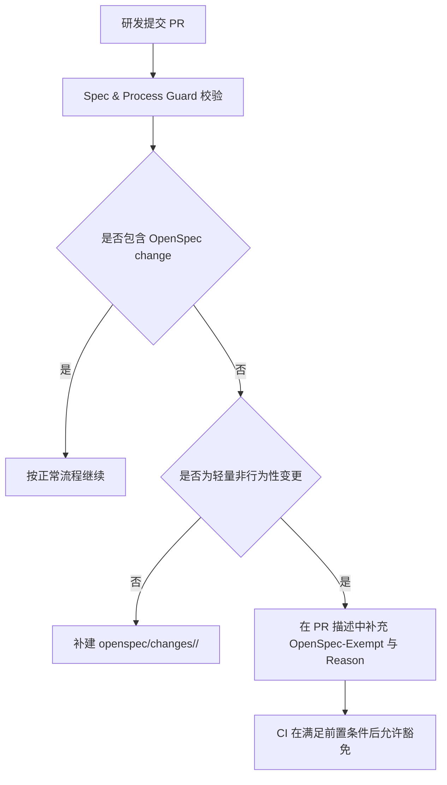

# Design: ai-process-openspec-exempt-guide

## 方案概览

本次通过新增一个独立的 OpenSpec change，沉淀 `Spec & Process Guard` 的 OpenSpec 豁免使用说明。方案不修改 CI 脚本逻辑，而是通过标准化 proposal、design、tasks 和 spec，把“何时建 change、何时可以豁免、PR 如何写”明确下来，作为团队统一执行依据。

## 现状分析

- 相关流程入口：`docs/ai/README.md`、`docs/ai/02-workflow.md`、`openspec/project.md`
- 相关校验脚本：`scripts/verify-ai-process.sh`
- 当前已有规则：
  - 中大变更必须提供 `openspec/changes/<change-id>/`
  - 轻量非行为性变更可以在 PR 描述中声明 `OpenSpec-Exempt: true`
  - 仅当 PR 描述满足要求后，CI 才应配合使用 `ALLOW_OPENSPEC_EXEMPT=true`
- 当前缺口：
  - 团队缺少一份专门针对报错场景的标准化中文说明
  - PR 描述模板分散在日志、脚本提示和历史经验中，不够集中

## 详细设计

### 文档结构设计

本次 change 目录包含以下文件：

| 路径 | 作用 |
|---|---|
| `proposal.md` | 说明为何需要补充该流程文档 |
| `design.md` | 说明文档组织方式、适用边界与执行约束 |
| `tasks.md` | 记录编写、校验与交付步骤 |
| `specs/ai-dev-process/spec.md` | 对 AI 开发流程能力追加规范要求 |

### 文档内容设计

文档至少应覆盖以下内容：

1. 典型报错场景  
   包括 `No OpenSpec change detected in this PR.` 以及后续提示语。

2. 必须建 change 的场景  
   明确接口、权限、数据结构、中间件、存储行为、部署行为、业务行为等变更不可豁免。

3. 允许豁免的场景  
   明确仅文档、注释、格式、错别字修复等轻量非行为性变更可豁免。

4. PR 描述标准模板  
   固定包含：

   ```text
   OpenSpec-Exempt: true
   Reason: <clear reason>
   ```

5. 中文规范示例  
   提供适合直接复制到 PR 描述中的中文示例。

6. 不合规示例  
   例如仅写“Reason: 小改动”等模糊表述。

7. 推荐处理步骤  
   指导研发先判断是否需要 change，再决定是否使用豁免。

### 接口设计

本次无新增接口、无接口契约变更。

### 数据设计

本次无数据库、缓存、索引、中间件数据结构变更。

### 业务流程



### 中间件影响

- Redis：无
- Kafka：无
- Elasticsearch：无
- Nacos：无
- R2/S3：无

## 兼容性

- 老流程是否保留：是。原有 OpenSpec 规则不变。
- 老数据是否可读：不涉及。
- 前端是否需要同步：否。
- 灰度期间新旧版本是否兼容：是。本次仅文档规范变更。

## 测试计划

- 执行 `bash scripts/verify-ai-process.sh`
- 检查新增 change 目录结构是否符合 `openspec/changes/README.md`
- 检查文档内容是否覆盖报错、模板、反例和处理步骤

## 发布与回滚

- 发布步骤：提交本次变更并随 PR 一起合入
- 验证命令：`bash scripts/verify-ai-process.sh`
- 回滚步骤：删除或回滚 `openspec/changes/ai-process-openspec-exempt-guide/`
