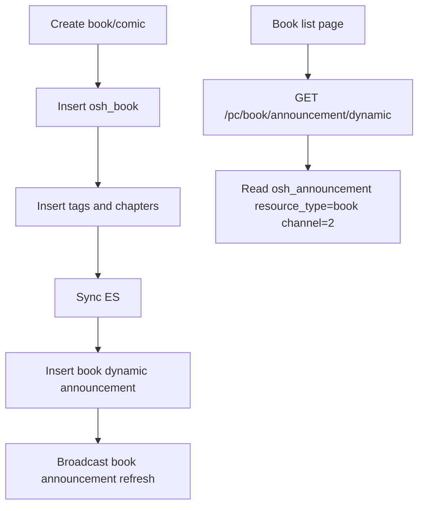

# Design: book-announcement-backend

## Overview

Add a small book announcement controller that reuses the shared announcement query service. Extend book creation to insert a published dynamic announcement into `osh_announcement` after the `osh_book` row has been created, then broadcast the standard book announcement refresh event.

## Current Analysis

- Frontend book announcements use `/book/announcement/notice` and `/book/announcement/dynamic`.
- `osh_announcement` stores shared announcement metadata using `resource_type`, `channel`, `resource_id`, `link`, and `source_module`.
- `AnnouncementMarqueeQueryServiceImpl` can query announcements by `AnnouncementModuleEnum` and channel.
- `BookServiceImpl.createBook` is the central book/comic creation path.

## Detailed Design

### Interface Design

| Method | Path | Change | Compatibility |
|---|---|---|---|
| GET | `/pc/book/announcement/notice?limit=5` | Add public query endpoint | Additive |
| GET | `/pc/book/announcement/dynamic?limit=5` | Add public query endpoint | Additive |

### Data Design

| Table | Change | Migration | Rollback |
|---|---|---|---|
| `osh_announcement` | Insert rows for newly created books/comics | No schema change | Soft delete inserted rows if needed |

Book create announcements:

- `resource_type`: `book`
- `source_module`: `book`
- `channel`: `2`
- `status`: `4`
- `source`: `system`
- `link`: `/detail/book/{bookId}`
- `icon_code`: `book` for ebooks, `comic` for comics

### WebSocket Refresh

After the book dynamic announcement is inserted, the backend uses `AnnouncementRefreshBroadcaster` to publish the standard refresh message listened to by the shared announcement board:

- `type`: `ANNOUNCEMENT_REFRESH`
- `content.module`: `book`
- `content.action`: `refresh`
- `content.refresh`: `true`

### Business Flow

## Compatibility

- Existing book APIs are unchanged.
- Frontend announcement board already accepts the shared announcement VO fields.

## Test Plan

- Compile `backstage-system`.
- Smoke query both new announcement endpoints.
- Create a book or inspect created records to verify `osh_announcement` receives `resource_type='book'`.
- Verify new book creation triggers the book announcement board refresh event.

## Release And Rollback

- Release backend with the additive endpoints.
- Roll back by reverting the controller and announcement insert call.
