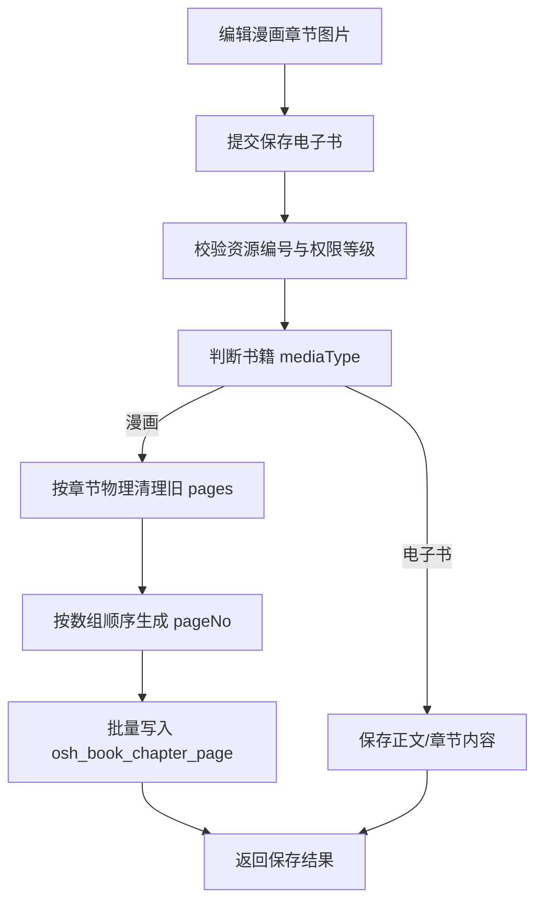

# Design: book-bookmark-enhancement

## 方案概览

电子书模块围绕“阅读书签”和“漫画页存储”两个方向增强：书签能力在原有章节阅读基础上增加高亮、去重、标签和定位；漫画能力在书籍层新增媒体类型字段，并使用 MySQL 表保存章节图片页快照。漫画保存时以后端接收到的图片数组顺序为准，先清理章节旧页，再重建连续页码。

## 现状分析

- 相关模块：`backstage-system` 电子书模块、前端电子书阅读/编辑页。
- 相关接口：章节详情、电子书保存、书签列表/新增/删除、电子书导入占位接口。
- 当前数据结构：电子书主表 `osh_book`、章节表、书签表；漫画页新增 `osh_book_chapter_page`。
- 当前配置：资源编号沿用 `ResourceCodePrefixEnum.BOOK`，不新增漫画专用资源编号。

## 详细设计

### 接口设计

| Method | Path | 变化 | 兼容策略 |
|---|---|---|---|
| GET | 章节详情接口 | 漫画书籍下返回 `pages` | 电子书章节仍返回 Markdown/正文内容 |
| POST/PUT | 电子书保存接口 | 接收书籍级 `mediaType` 和漫画章节页数组 | 后端忽略旧 `pageNo`，按数组顺序重建 |
| POST | `/pc/book/import/ebook` | 暂时暴露电子书导入占位接口 | 仅占位，不解析落库 |
| GET/POST/DELETE | 书签相关接口 | 支持书签标签、颜色、进度、图片索引等字段 | 图片章节逻辑保持兼容 |

### 数据设计

| 表/索引/缓存 | 变化 | 迁移方式 | 回滚方式 |
|---|---|---|---|
| `osh_book.media_type` | 新增书籍级媒体类型，1=电子书，2=漫画 | 旧数据默认 1 | 保留字段不使用，或迁移回默认 1 |
| `osh_book_chapter_page` | 新增漫画章节页快照表 | 执行 `20260624_book_bookmark.sql` | 停止写入并保留数据，必要时备份后删除表 |
| `uk_book_chapter_page` | 当前页唯一约束为 `book_id, chapter_id, page_no, delete_flag` | SQL 迁移索引 | 恢复旧索引前需清理冲突数据 |
| 书签表 | 扩展标签、颜色、位置、图片索引等读写能力 | 增量字段兼容空值 | 保留字段不展示 |

### 业务流程

### 中间件影响

- Redis：无新增依赖。
- Kafka：无新增依赖。
- Elasticsearch：无新增依赖。
- Nacos：无新增配置。
- R2/S3：沿用现有图片资源上传/访问能力。

## 兼容性

- 老接口保留：电子书阅读与章节详情仍兼容正文内容。
- 老数据可读：未设置 `media_type` 的书籍按电子书处理。
- 前端同步：前端编辑页需传递书籍级 `mediaType` 和漫画页数组。
- 灰度兼容：后端可同时处理电子书正文章节与漫画页章节。

## 测试计划

- 保存电子书书签，验证高亮、去重、标签和删除确认。
- 保存漫画章节图片排序，验证 `page_no` 连续且无唯一键冲突。
- 查询漫画章节详情，验证 `pages` 按页码返回。
- 查询普通电子书章节，验证正文阅读不受影响。
- 验证 `/pc/book/import/ebook` 占位接口返回符合预期。
- 编译后端相关模块。

## 发布与回滚

- 发布步骤：执行 `20260624_book_bookmark.sql`，部署后端，部署同步前端。
- 验证命令：后端 `mvn compile`，前端 `npm run generate`。
- 回滚步骤：回滚应用代码；数据库字段和表优先保留，必要时备份漫画页数据后再执行回滚 SQL。
