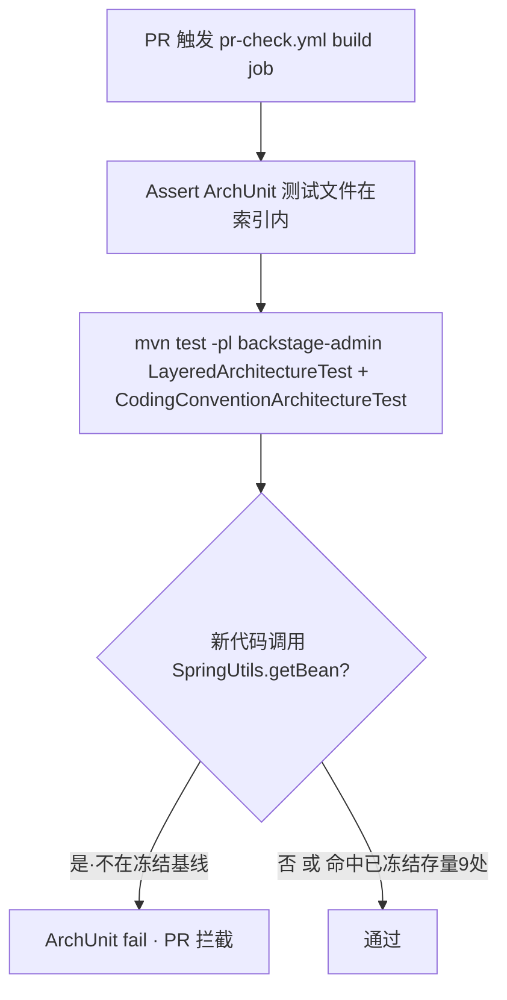

# Design: close-r4-gate-gap

## 方案概览

把红线 R4 的四条款按"当前能否被 ArchUnit 可靠表达"分两档收敛，杜绝"声明与抓手不符"的假合规：

- **R4④（禁 static 取 Bean）→ 升级为硬门禁**：在既有 `CodingConventionArchitectureTest`
  增一条 `SpringUtils.getBean` 调用禁令，套用与 `println`/裸 HTTP 同款的 `FreezingArchRule`
  冻结基线（现存 9 处 infra 入档只拦新增）。同时把 `CLAUDE.md` R4④ 检查列的 grep 类名
  由 `SpringUtil` 更正为真实类名 `SpringUtils`（复数），并注明已冻结强制。
- **R4③（跨域 Mapper）→ 如实降级 + 立前置**：当前包树"域轴不完整 + 双名漂移"使按域 ArchUnit
  规则会漏判/误判，本 change 不强凑，改为把 R4③ 检查列如实登记为"import 台账 + 评审拦截"，
  并把"按域纵切包规整化"确立为 R4③ 可机器化的**前置 change**（解锁条件写进 spec）。

## 现状分析

- 相关模块：`backstage-admin`（ArchUnit 测试落位，聚合全工程 `com.backstage.*` 字节码）。
- 相关类/接口：
  - 静态持有类 **`com.backstage.common.utils.spring.SpringUtils`**（`implements BeanFactoryPostProcessor, ApplicationContextAware`，
    暴露 `static <T> T getBean(String)` 与 `static <T> T getBean(Class<T>)` 两个重载）。
  - **不存在** `SpringUtil`（单数）类——`CLAUDE.md` R4④ 现正则 `SpringUtil\.getBean` 恒 0 命中 = 假合规。
  - 现存 `SpringUtils.getBean` 调用点（src/main，约 9 处）：
    `common/utils/DictUtils`、`common/utils/MessageUtils`、`framework/config/DruidConfig`、
    `framework/manager/AsyncManager`、`framework/manager/factory/AsyncFactory`、
    `quartz/util/ScheduleUtils`、`quartz/util/JobInvokeUtil`、`quartz/util/AbstractQuartzJob`、
    `system/utils/ResourcePermissionUtil`。多为 RuoYi 框架装配/定时任务反射调用，属"存量正确性存疑但短期不清"。
  - 既有测试：`LayeredArchitectureTest`（R4①②，已 freeze 分层方向 + Controller→Mapper）、
    `CodingConventionArchitectureTest`（R5，普通断言禁 `e.printStackTrace`；freeze 拦 `println`/裸 HTTP 新增）。
  - `backstage-admin/src/test/resources/archunit.properties` 已设 `freeze.store.default.path=archunit-store`、
    `allowStoreCreation=true`；基线目录 `backstage-admin/archunit-store/` 必须入 git 索引。
- 当前数据结构：**不适用**（无库表变更）。
- 当前配置：R4③④ 抓手仅存在于 `CLAUDE.md` 文本描述，无 CI 实跑；`pr-check.yml` build job 已跑两个 ArchUnit 测试
  且前置 `Assert ArchUnit test files present` 断言（由 `enhance-harness-closure` 建立）。
- 包树形态（R4③ 不可干净机器化的根因，实测）：`system.mapper` 下 39 个域子包 + **16 个扁平 Mapper**；
  `system.controller` 并存 `flashsale`/`seckill`、`internal`/`internalmember`（同域裂两名）；
  `system.service` 混有扁平 `impl`。→ 无稳定"域包"锚点可写 `..service.<域A>.. NOT depend ..mapper.<域B>..`。

## 详细设计

### 接口设计

不适用。本 change 不新增/修改任何 HTTP 接口，纯测试代码 + 治理文档 + 冻结基线数据。

### 数据设计

无库表变更。唯一"数据"为 ArchUnit 冻结基线文件：

| 产物 | 变化 | 生成方式 | 回滚方式 |
|---|---|---|---|
| `archunit-store/<ruleStoreId>.properties`（新增 1 个） | 新增 R4④ 规则的存量违例基线（9 处） | 本地首跑 `mvn test` 自动生成，人复核后提交 | 删该 `.properties` 即撤基线（连同规则一起撤） |

### 规则草图（R4④，实现阶段用；API 须按 ArchUnit 1.x 核对）

沿用已验证可编译的"显式重载"写法（规避 `callMethodWhere` 复杂谓词的 `name(DescribedPredicate)` 重载不存在问题）：

```java
@ArchTest
public static final ArchRule 禁止经SpringUtils运行时取Bean = FreezingArchRule.freeze(
    noClasses()
        .should().callMethod(SpringUtils.class, "getBean", String.class)
        .orShould().callMethod(SpringUtils.class, "getBean", Class.class)
        .as("[违规] 禁经 SpringUtils.getBean 运行时取 Bean（R4④，编译期看不见、静态扫描最难抓）。\n"
          + "[修复] 用构造器/字段注入声明依赖；确需运行时取 Bean 的场景须走评审并记 candidate。\n"
          + "[参考] CLAUDE.md R4④、docs/architecture/module-dependency-rules.md"));
```

> 注意（记忆库既有坑）：若改用 `dependOnClassesThat()` 选择器，方法名是 `resideInAPackage`/`resideInAnyPackage`
> （带 A），不是 `resideInPackage`。本规则用 `callMethod` 显式重载更稳。

### R4③ 为什么本 change 不做（决策留档）

`Service→跨域 Mapper` 需要"域"作为可判定的包锚点。当前 16 个扁平 Mapper 无域包、双名域裂包，
任何 `service.<域A> NOT depend mapper.<域B>` 规则都会**系统性漏判**（抓不到扁平 Mapper 与另一别名包）。
与其上一道"看着绿、实则抓不全"的门禁（正是本次审计要消灭的假合规），不如如实标注为评审级，
待前置"按域纵切包规整化"完成后，再另立 change 上 ArchUnit。

### 业务流程（门禁生效路径）



### 中间件影响

不适用。Redis/Kafka/ES/Nacos/R2 均不涉及（纯 CI 测试门禁）。

## 兼容性

- 老接口是否保留：不适用（无接口变更）。
- 老数据是否可读：不适用。
- 前端是否需要同步：**不需要**。
- 灰度期间新旧是否兼容：不适用；ArchUnit 仅在 CI 构建期评估字节码，不影响运行时。

## 测试计划

- 单元测试：`mvn test -pl backstage-admin -am -Dtest=CodingConventionArchitectureTest`
  首跑因 `allowStoreCreation=true` 自动生成基线并放行 9 处存量 → **必绿**（这是冻结语义，非未拦截）。
- 集成/自证：临时新增一个业务类调用 `SpringUtils.getBean(...)`，复跑测试应判**新增违例 fail**，验证后删除该类。
- 回归范围：确认既有 `println`/裸 HTTP/`printStackTrace`/分层规则仍绿，基线 storeId 不冲突。

## 发布与回滚

- 发布步骤：① 改 `CLAUDE.md` R4③④ 检查列文本（随本 change 携四件套，满足"触碰行为须带 change"）；
  ② `CodingConventionArchitectureTest` 增规则；③ 本地 `mvn test` 生成基线；④ `git add` 测试文件与 `archunit-store/` 基线；⑤ 提 PR。
- 验证命令：`mvn test -pl backstage-admin -am -Dtest='LayeredArchitectureTest,CodingConventionArchitectureTest'`；
  `powershell -File scripts/preflight.ps1` 看四件套齐全。
- 回滚步骤：撤 `CodingConventionArchitectureTest` 的规则 + 删对应 `archunit-store/<ruleStoreId>.properties` +
  还原 `CLAUDE.md` R4 文本；无生产回滚（未触运行时）。

## 待用户拍板的决策点

见提案交付时随附的选项（冻结基线 vs infra 包白名单 vs 仅软 grep 修正不进门禁）。本 change 推荐 **方案 A（冻结基线只拦新增）**。
