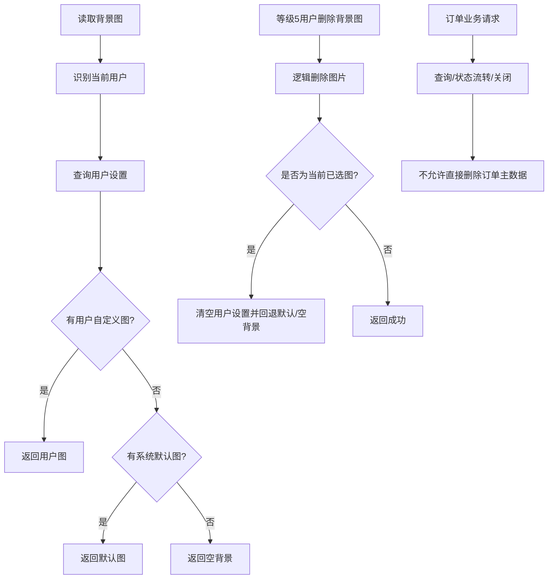

# Design: contentbg-management-and-order-delete-guard

## 方案概览

本次 change 只补规格，不新增实现。规格层面把两类行为写清楚：

1. 内容背景图能力由内容背景服务统一处理，读取接口允许匿名访问，管理接口要求等级 5；删除采用逻辑删除，并在删除当前已选图片时清理用户设置，回退到默认图或空背景。
2. 订单相关服务移除直接删除路径，只保留查询、状态流转和业务关闭语义，避免订单主数据被误删。

## 现状分析

- 相关模块：
  - `backstage-system` 内容背景图控制器、服务、Mapper。
  - `backstage-system` 订单 Controller / Service / Mapper。
- 相关类/接口：
  - `ContentBackgroundController`
  - `IContentBackgroundService`
  - `ContentBackgroundServiceImpl`
  - `OrderService` 及订单相关 service / mapper
- 当前数据结构：
  - `osh_content_bg_image`
  - `osh_user_content_bg_setting`
  - 订单相关主表与明细表
- 当前配置：
  - 内容背景图上传走 R2/S3 兼容对象存储。
  - 权限通过 `@OshUserLevel` 和前端会员等级判断控制。

## 详细设计

### 接口设计

| Method | Path | 变化 | 兼容策略 |
|---|---|---|---|
| GET | `/pc/content-background/options` | 匿名可访问，按登录态返回用户背景/默认背景/空背景 | 保留原读取路径 |
| POST | `/pc/content-background/image/upload` | 等级 5 上传内容背景图 | 保留上传路径 |
| POST | `/pc/content-background/setting/save` | 登录用户切换当前背景图 | 保留切换路径 |
| POST | `/pc/content-background/image/delete` | 新增等级 5 删除背景图 | 逻辑删除 |
| 订单相关删除路径 | 不再提供删除能力 | 移除/禁用 | 调用方改用查询或状态管理 |

### 数据设计

| 表/索引/缓存 | 变化 | 迁移方式 | 回滚方式 |
|---|---|---|---|
| `osh_content_bg_image` | 使用 `delete_flag` 表示逻辑删除 | 无需迁移 | 恢复旧逻辑时可重新放开读取 |
| `osh_user_content_bg_setting` | 删除当前已选图片时清空引用 | 在线更新 | 恢复旧逻辑时重新保存选择 |
| 订单相关表 | 不再允许业务删除 | 无结构变更 | 如需恢复删除行为再单独建 change |

### 业务流程

### 中间件影响

- Redis：无新增要求。
- Kafka：无影响。
- Elasticsearch：无影响。
- Nacos：无配置变更要求。
- R2/S3：背景图上传与签名 URL 继续复用现有对象存储能力。

## 兼容性

- 老接口是否保留：背景图读取/上传/切换保留；订单删除路径不再保留。
- 老数据是否可读：是。
- 前端是否需要同步：是，需同步背景图管理入口与订单相关操作入口。
- 灰度期间新旧版本是否兼容：背景图读取兼容；订单删除能力需前后端同时约束。

## 测试计划

- 单元测试：
  - 内容背景图删除逻辑。
  - 删除当前已选图片后的用户设置回退。
- 集成测试：
  - 背景图删除接口权限。
- 接口 smoke：
  - `/pc/content-background/options`
  - `/pc/content-background/image/upload`
  - `/pc/content-background/image/delete`
- 回归范围：
  - 登录/未登录背景图展示。
  - 等级 5 管理能力。
  - 订单模块不再暴露删除能力。

## 发布与回滚

- 发布步骤：
  1. 合并本次 PR。
  2. 验证背景图读取、上传、删除接口与订单模块主流程。
- 验证命令：
  - `bash scripts/verify-ai-process.sh`
  - `mvn clean install -DskipTests -pl '!backstage-flink'`
- 回滚步骤：
  - 回滚本 PR 代码与本 change 文档。
  - 若需恢复订单删除能力，必须另建 OpenSpec change。
