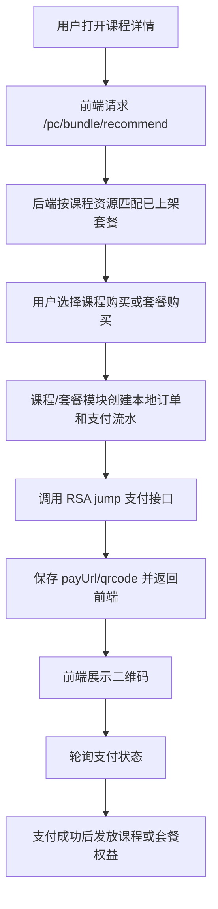

# Design: course-bundle-payment-qr

## 方案概览

在课程/套餐模块内新增专用支付创建服务，复用既有订单号、订单表、支付流水表和套餐权益发放逻辑。课程单品和套餐购买不再通过公共旧支付创建二维码，而是在模块内创建待支付订单和支付流水，再调用 RSA `jump` 支付接口生成可扫码链接。公共支付配置类和公共支付服务保持原样，避免影响其他支付入口。

## 现状分析

- 相关模块：课程支付、套餐推荐、套餐支付。
- 相关类/接口：`CoursePayController`、`CoursePayServiceImpl`、`BundleController`、`ProductBundleServiceImpl`。
- 当前数据结构：复用 `osh_order`、`osh_payment`、`osh_course_buy`、`osh_product_bundle`、`osh_bundle_item`。
- 当前配置：复用 `pay.merchant-id`、`pay.notify-url`，RSA 私钥优先读取 `pay.private-key`，本地开发可用 `pay.private-key-file` 兜底。

## 详细设计

### 接口设计

| Method | Path | 变化 | 兼容策略 |
|---|---|---|---|
| POST | `/pc/course/pay/create` | 课程购买改为课程/套餐专用 RSA jump 支付创建 | 响应继续返回 `qrcode`、`payurl`、`payUrl`、`orderNo` |
| GET | `/pc/course/pay/status` | 保持课程支付状态查询入口 | 继续兼容 `out_trade_no` 和 `orderNo` |
| GET | `/pc/bundle/recommend` | 新增按资源查询上架套餐推荐 | 新接口，不影响后台套餐管理 |
| POST | `/pc/bundle/pay/create` | 新增套餐购买支付创建 | 响应字段与课程支付保持一致 |
| GET | `/pc/bundle/pay/status` | 新增套餐支付状态查询并触发权益发放 | 新接口，仅套餐模块使用 |

### 数据设计

| 表/索引/缓存 | 变化 | 迁移方式 | 回滚方式 |
|---|---|---|---|
| `osh_order` | 写入课程/套餐待支付订单 | 无需迁移 | 回滚代码后历史订单可保留 |
| `osh_payment` | 写入支付流水及支付平台返回链接 | 无需迁移 | 回滚代码后历史流水可保留 |
| `osh_course_buy` | 课程支付创建待支付记录，支付成功后标记已购 | 无需迁移 | 回滚代码后历史购买记录可保留 |
| `osh_product_bundle` | 读取套餐封面和上架状态 | 无需迁移 | 无 |
| `osh_bundle_item` | 按资源匹配推荐套餐并发放权益 | 无需迁移 | 无 |

### 业务流程

### 中间件影响

- Redis：无新增。
- Kafka：无新增。
- Elasticsearch：无新增。
- Nacos：可选补充 `pay.private-key` 或 `pay.private-key-file`，公共支付类不依赖新增字段。
- R2/S3：套餐封面继续使用现有签名 URL 能力，不新增存储写入。

## 兼容性

- 老接口是否保留：课程支付接口保留；新增套餐 C 端接口。
- 老数据是否可读：订单、支付流水、课程购买、套餐数据继续可读。
- 前端是否需要同步：需要前端课程详情页展示套餐推荐和套餐支付弹窗。
- 灰度期间新旧版本是否兼容：新前端依赖后端 `/pc/bundle/*` 接口；后端新支付响应字段保持旧前端可读。

## 测试计划

- 后端编译：`mvn -pl backstage-admin -am -DskipTests compile`。
- 支付平台 smoke：使用 RSA `jump` 参数直连支付平台，确认返回 `pay/submit/...` 链接。
- 接口 smoke：重启 release 后端后登录用户，分别调用课程支付和套餐支付创建接口确认返回二维码字段。
- 回归范围：课程详情页、课程单品购买、套餐推荐、套餐详情购买、后台套餐封面保存。

## 发布与回滚

- 发布步骤：发布后端课程分支，确认配置包含可用 RSA 私钥；发布前端课程分支。
- 验证命令：课程详情页点击课程购买和套餐购买，确认二维码弹出。
- 回滚步骤：回滚本次前后端提交；公共支付模块未改动，无需额外恢复公共支付代码。
