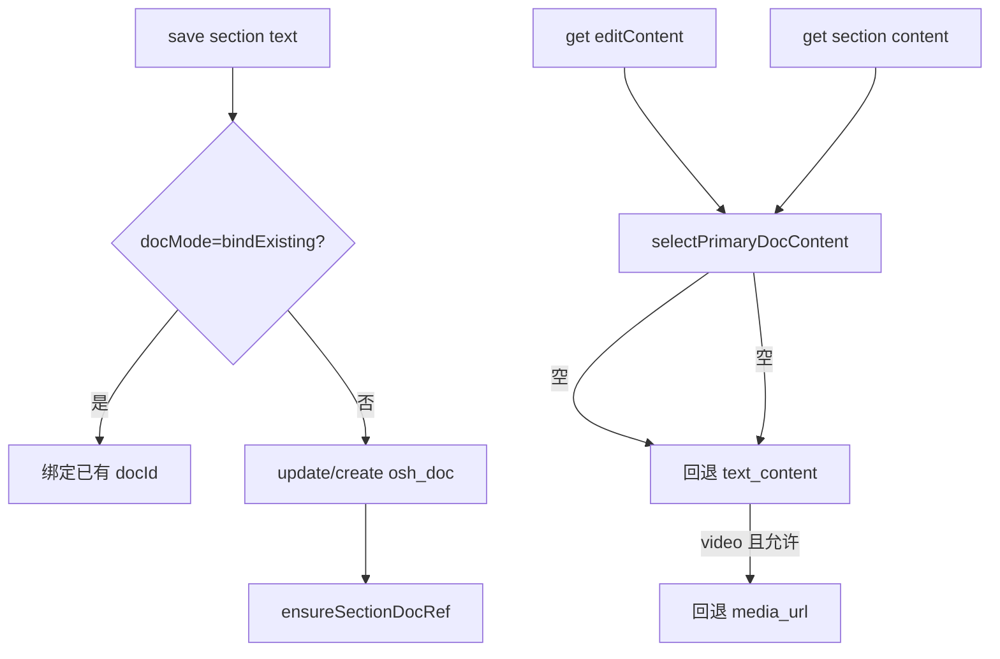

# Design: course-section-doc-save-read

## 方案概览

在 `OshCourseServiceImpl` 中抽取 `resolveSectionDocContent(sectionId, allowVideoMediaFallback)`，写入仍走 `saveOrBindSectionDoc` 更新 `osh_doc`；读取时优先 doc 表，再回退 section.text_content；编辑接口关闭 video media 回退。

## 现状分析

- 相关模块：`OshCourseServiceImpl`、`OshCourseController`、`CourseManageController`。
- 写入：`saveOrBindSectionDoc` 更新/创建 `osh_doc` 并绑定 section。
- 问题：读取可能仅查 `text_content` 或 bind 模式误判，导致与 `osh_doc` 不同步。

## 详细设计

### 接口设计

| Method | Path | 变化 | 兼容策略 |
|---|---|---|---|
| GET | `/pc/course/manage/section/{id}/editContent` | 读取逻辑统一 | 优先 osh_doc |
| GET | `/pc/course/section/content` | 读取逻辑统一 | video 可回退 media_url |
| POST | `/pc/course/manage/section/text` | saveOrBindSectionDoc 行为修正 | bind 仅 docMode 触发 |

### 状态与数据设计

| 数据 | 变化 | 兼容方式 |
|---|---|---|
| `osh_doc.content` | 保存时主写入目标 | 已有 doc 则 update |
| `osh_course_section.text_content` | 读取回退源 | 历史数据仍可读 |
| `docMode` | bindExisting 判定唯一依据 | 不再因 docId 单独推断 bind |

### 业务流程

## 兼容性

- 仅写 `text_content` 的历史小节仍可通过回退读取。
- 前端需使用字符串 sectionId，避免精度丢失。

## 测试计划

- 集成测试：`OshCourseControllerSectionApiTest`
- Smoke：保存 text 小节 → editContent → 学员 content 一致

## 发布与回滚

- 后端 `feature/course_hero_hope_xinghao` 已 Fast-forward 合并 `qa/20260708`（`73a1b668`）。
- 前端 `feature/course_xinghao` 已同步合并 `qa/20260708`，Markdown 保存 / 学习中心读取联调通过。
- 与前端同期合并至 qa 后，在 25 环境做回归验证。
- 回滚：revert `e0c0b5db`（读写逻辑）；OpenSpec 文档可单独 revert `4becad67`。
