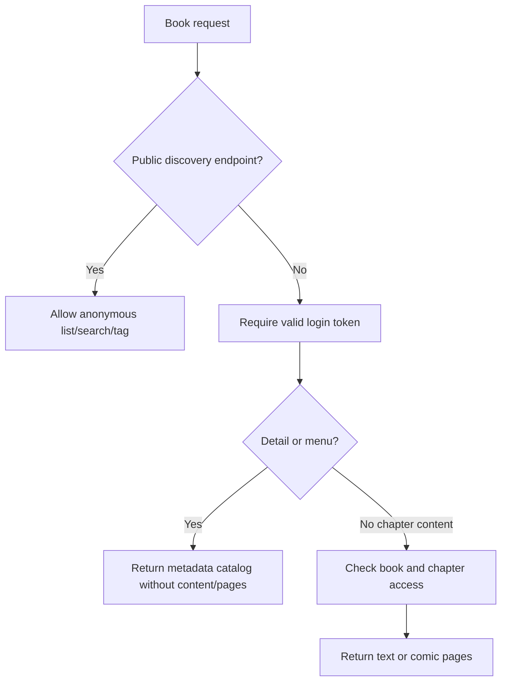

# Design: fix-book-content-access-control

## Overview

Apply two layers of defense for the book module: authentication boundary at the controller and response minimization at the service. Public discovery endpoints stay anonymous, while detail/menu/chapter endpoints require a valid token. Metadata endpoints return only book and chapter catalog fields; real text and comic image URLs are returned only by the chapter content endpoint after access checks.

## Current Analysis

- `BookController` marks `/getById`, `/detail`, and `/menus` with `@Anonymous`.
- `OshAuthenticationFilter` skips token enforcement for `@Anonymous` URLs.
- `BookServiceImpl.buildBookDetailVO` attaches comic pages to all chapters for normal detail responses.
- `BookServiceImpl.selectBookMenu` also attaches comic pages for comic books.
- `BookChapterMapper.selectBookChapterListByBookId` loads `content` into chapter list VOs.

## Detailed Design

### Interface Design

| Method | Path | Change | Compatibility |
|---|---|---|---|
| POST | `/pc/book/page` | Keep `@Anonymous` | Public list unchanged |
| POST | `/pc/book/search` | Keep `@Anonymous` | Public search unchanged |
| GET | `/pc/book/getTagList` | Keep `@Anonymous` | Public tags unchanged |
| GET | `/pc/book/getById` | Remove `@Anonymous`; normal response omits chapter content/pages | Detail page keeps catalog metadata; reading content must use chapter endpoint |
| GET | `/pc/book/detail` | Remove `@Anonymous`; keep chapter access checks | Authenticated content endpoint |
| GET | `/pc/book/menus` | Remove `@Anonymous`; omit chapter content/pages | Menu metadata only |
| POST | `/pc/upload/preview-urls` | Require `@OshUserLevel(4)` | Prevent normal users from signing arbitrary known object paths |

### Business Flow

### Data Design

No table, index, or cache change.

### Response Minimization

- Add a service helper to sanitize chapter list VOs by clearing `content` and `pages`.
- For `selectBookDetail(..., forEdit=false)`, return sanitized chapter catalog only.
- For `selectBookDetail(..., forEdit=true)`, keep existing editor behavior and require manager level before returning original editable content/pages.
- For `selectBookMenu`, always sanitize menu chapters and never attach comic pages.
- Bulk preview URL signing is manager-only because it accepts raw object keys and cannot infer book/chapter read ownership from the current request body.

## Compatibility

- Existing frontend detail/catalog rendering should continue if it only depends on `id`, `title`, `chapterNo`, `sortOrder`, and `isFree`.
- Any client that incorrectly read comic pages from `getById` or `menus` must switch to `/pc/book/detail`.

## Test Plan

- Unit test normal detail sanitization for comic chapter pages.
- Unit test menu sanitization.
- Existing VIP paid chapter access tests continue to verify paid content access.
- Run targeted backend tests for the book service module.

## Release And Rollback

- Release with backend and frontend compatible changes together.
- Verify unauthenticated curl to `/pc/book/getById` returns 401.
- Verify authenticated `/pc/book/getById` has no `book_details[].pages[].imageUrl`.
- Roll back by reverting this change set if frontend compatibility issue appears.
