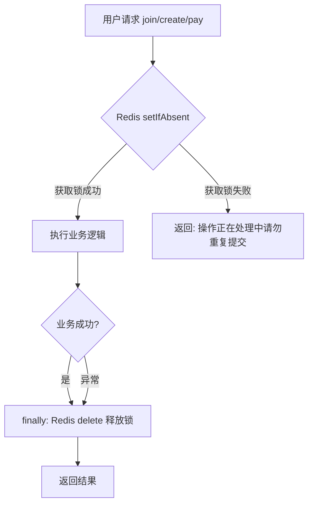
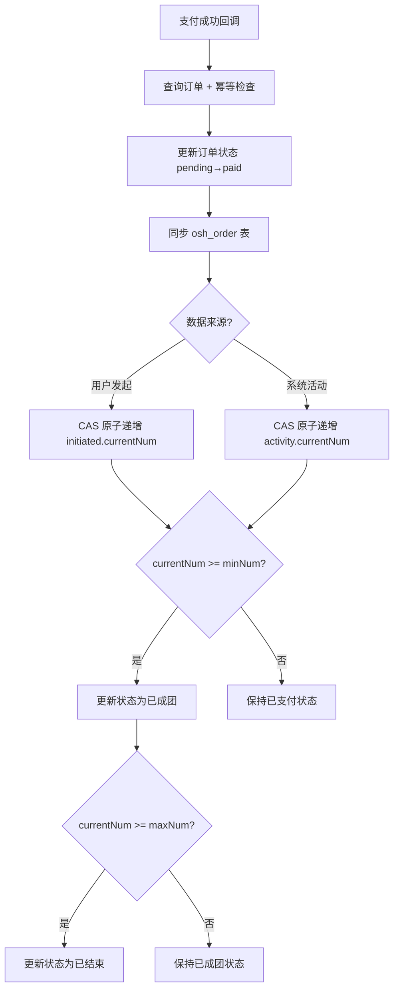

# Design: fix-group-module-quality

## 方案概览

对拼团模块进行系统性代码质量治理，分四层实施：安全加固（分布式锁 + 权限 + 越权防护）→ 类型安全（枚举 + 常量 + 强类型 VO）→ 业务一致性（时间戳 + 订单前缀 + 状态映射修复）→ 规范化（日志格式 + @Log + Swagger 文档）。所有变更保持 JSON 接口兼容，前端无需修改。

## 现状分析

- 相关模块：backstage-system（拼团 servergroup、order、group 三个 controller 包 + service 层）
- 相关类/接口：
  - `OshGroupServerController`（C 端拼团主控制器，~580 行）
  - `OshGroupOrderController`（C 端订单控制器，~114 行）
  - `GroupController`（C 端课程/专栏控制器，~65 行）
  - `OshGroupServerServiceImpl`（核心 Service，~1970 行）
  - `IOshGroupServerService`（Service 接口）
  - `PcExceptionHandler`（全局异常处理器）
- 当前数据结构：
  - `osh_group_work.group_status`：0=待支付, 1=已支付, 2=已成团, 3=已结束
  - `osh_group_user_initiated.group_status`：0=招募中, 1=已成团, 2=已结束（独立映射）
  - `osh_group_order.status`：字符串 "pending"/"paid"/"success"/"cancelled"/"refunded"
- 当前配置：无 Nacos 配置变更

## 详细设计

### 接口设计

| Method | Path | 变化 | 兼容策略 |
|---|---|---|---|
| POST | `/pc/group/work/join` | 新增 Redis 分布式锁 + @Log(INSERT) + @RateLimiter | 快速连点返回友好提示，正常请求无变化 |
| POST | `/pc/group/work/create` | 新增 Redis 分布式锁 + @Log(INSERT) | 同上 |
| POST | `/pc/group/work/pay` | 新增 Redis 分布式锁 + @Log(UPDATE) + 订单归属校验 | 同上 + 非本人订单返回 403 |
| GET | `/pc/group/activity/initiable` | 手写 userLevel<=2 → @PreAuthorize("hasAuthority('group:activity:initiable')") | 需确保角色已配置该权限 |
| POST | `/pc/group/work/addUserToGroup` | 返回类型 Map → AddUserToGroupVO + @Log(INSERT) | JSON 字段完全一致，前端无感 |
| GET | `/pc/group/order/status` | 返回类型 Map → GroupOrderStatusVO + 订单归属校验 | JSON 字段完全一致 |
| GET | `/pc/group/course/read` | 保持 @Anonymous | 无变化 |
| GET | `/pc/group/column/read` | 保持 @Anonymous | 无变化 |
| POST | `/pc/order/group` | 保持 @Anonymous + 补 @Log(INSERT) | 无变化 |

### 数据设计

| 表/索引/缓存 | 变化 | 迁移方式 | 回滚方式 |
|---|---|---|---|
| `osh_group_user_initiated.group_status` | 修复满员时写入值 3→2 | 代码修复，无需数据迁移 | 回退代码 |
| Redis 新增锁 Key | `group:lock:join:*`、`group:lock:create:*`、`group:lock:pay:*`（TTL 10s） | 无需迁移，自动过期 | 移除锁代码 |

### 业务流程

#### 分布式锁防护流程

#### 支付回调状态流转（修复后）

### 新增基础类设计

| 类名 | 类型 | 用途 |
|------|------|------|
| `GroupStatusEnum` | 枚举 | 组团状态：PENDING(0)/PAID(1)/FORMED(2)/ENDED(3)，含 C 端展示文字 |
| `GroupOrderStatusEnum` | 枚举 | 订单状态：PENDING/PAID/SUCCESS/REFUNDED/CANCELLED，含 isPaidOrSuccess() |
| `GroupConstants` | 常量类 | 订单前缀、SSH 默认值、Redis 锁 Key、缓存 Key、日志标识等 35 个常量 |
| `AddUserToGroupVO` | VO | 手动添加用户响应（8 字段），替代 Map |
| `GroupOrderStatusVO` | VO | 订单状态查询响应（6 字段），替代 Map |

### 双状态码体系（关键架构知识）

| 状态码 | `osh_group_work` / `osh_group_activity` (GroupStatusEnum) | `osh_group_user_initiated`（独立映射） |
|--------|-----------------------------------------------------------|---------------------------------------|
| 0 | 待支付 / 招募中 (PENDING) | 招募中 |
| 1 | 已支付 (PAID) | 已成团 |
| 2 | 已成团 (FORMED) | 已结束 |
| 3 | 已结束 (ENDED) | — 无此值 |

> 两套映射语义不同。initiated 的"已结束"=2，而 GroupStatusEnum 的"已结束"=3。代码中对 initiated 相关操作保留原始值并添加注释说明。

### 中间件影响

- Redis：新增 3 类分布式锁 Key（`group:lock:join/create/pay:*`，TTL=10s），新增 2 类缓存 Key 引用 GroupConstants 常量管理
- Kafka：无影响
- Elasticsearch：无影响
- Nacos：无影响
- R2/S3：无影响

## 兼容性

- 老接口是否保留：是，所有接口路径和 HTTP 方法不变
- 老数据是否可读：是，无表结构变更
- 前端是否需要同步：否，VO 字段与原 Map key 完全一致，JSON 序列化结果不变
- 灰度期间新旧版本是否兼容：是，分布式锁 Key 自动过期，无持久化状态

## 测试计划

- 单元测试：GroupPriceCalculator 价格计算、GroupStatusEnum/GroupOrderStatusEnum 枚举转换
- 集成测试：join/create/pay 分布式锁互斥验证、支付回调状态流转验证
- 接口 smoke：所有 C 端拼团接口正常响应验证
- 回归范围：拼团列表、详情、参团、发起、支付、手动加人、订单状态查询

## 发布与回滚

- 发布步骤：
  1. 确认 `group:activity:initiable` 权限已配置到对应角色
  2. 发布后端代码
  3. 验证关键接口 smoke
- 验证命令：
  - `curl -X POST /pc/group/work/join` 快速连点两次，第二次应返回"操作正在处理中"
  - `curl /pc/group/activity/initiable` 无 token 应返回 401
- 回滚步骤：回退代码到修复前版本，Redis 锁 Key 10 秒后自动过期
