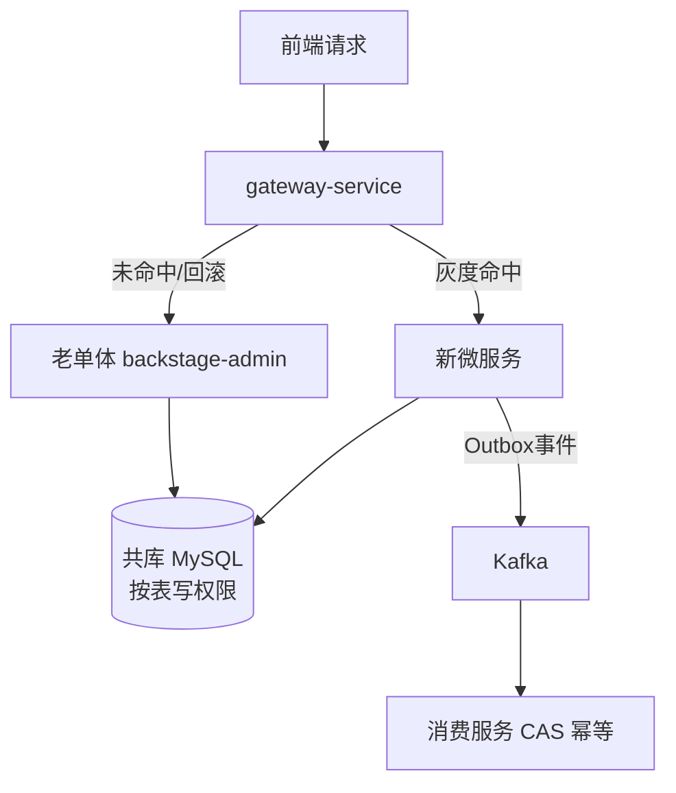

# Design: plan-microservice-split-roadmap

## 方案概览

采用绞杀者模式（Strangler Fig）渐进拆分：先建设网关与可观测性基建（Phase 0），再按"低风险域先行、高并发交易域最后"的顺序将 37 个业务域迁入 7 个粗粒度微服务（Phase 1~3），最后按需做数据物理分库（Phase 4）。过渡期所有服务共用现有 MySQL 实例（按表划分写权限），URL/权限字符串/锁 key/LoginUser key 四类契约冻结，网关灰度切流，老单体代码在双跑期内保留以支持秒级路由回滚。

## 现状分析

- 相关模块：`backstage-admin`（Web 入口，61 类）、`backstage-framework`（安全/配置/Kafka 消费者）、`backstage-system`（37 个业务域，1296 类）、`backstage-common`（工具/注解/切面）、`backstage-quartz`（Quartz+XXL-Job 双调度，23 个定时任务）、`backstage-flink`（Kafka→ES 同步，独立作业）、`backstage-hbase`（独立作业）。
- 相关类/接口：`TokenFilter`（鉴权过滤器，将上移网关）、`OutboxEventServiceImpl`（course/tool/seckill 三类聚合事件）、`GroupEventPublisher`（事务后直发 Kafka）、`@DistributeLock`（声明式分布式锁）、三重闸门范式（Redis Lua → DB 条件更新 → SELECT FOR UPDATE）。
- 当前数据结构：单 MySQL 库，表前缀 `sys_*`（RuoYi RBAC）与 `osh_*`（业务）；`osh_outbox_event` 事件表；ES 6.8 索引经 Flink a/b 双索引轮换。
- 当前配置：Nacos 统一配置（含 osh-secret 敏感隔离）、bootstrap.yml 在 backstage-admin。

## 详细设计

### 技术决策记录（ADR 摘要，已确认）

| # | 决策点 | 结论 | 理由 | 被否方案 |
|---|---|---|---|---|
| 1 | 拆分策略 | 绞杀者渐进式 | 有在线支付/秒杀业务，不允许停机切换；网关路由级回滚是核心保险 | 一次性重写（切换日风险极高）；纯模块化单体（解决不了资源隔离与独立发布） |
| 2 | 服务粒度 | 粗粒度 7 服务 | 跨服务事务最少、运维成本可控；服务内部按包保持域边界，成熟一个再裂变 | 细粒度 11 服务（部署/监控/联调成本对当前团队过大） |
| 3 | 同步 RPC | OpenFeign + 独立 `xxx-api` 契约模块 | 与 Spring Cloud/Nacos 栈无缝集成，HTTP+JSON 调试直观，学习成本≈0 | Dubbo 3（引入第二套序列化/线程模型/监控生态） |
| 4 | 分布式事务 | Outbox 可靠消息 + SAGA 补偿 | 复用现有 osh_outbox_event、CAS 幂等闸门、三重闸门实践；无全局锁性能损耗 | Seata AT（全局锁与秒杀/拼团高并发场景冲突）；核心链路 Seata 混合（两套事务模型排查复杂度高） |

### 服务边界定义（7 服务）

| # | 服务 | 职责 | 承接现有域（backstage-system/controller 与 domain 包） | 数据归属（写权限） | 远期裂变 |
|---|---|---|---|---|---|
| 1 | gateway-service | 统一入口、路由、鉴权粗校验、全局限流、灰度分流 | 新增，无老代码 | 无 | — |
| 2 | auth-user-service | 登录认证、JWT 签发、RBAC、C端用户、会员账户、行为记录 | user、member、internalmember、behavior、system(RuoYi RBAC) | sys_*、osh_user*、osh_member*、osh_internal_member* | member-service |
| 3 | course-service | 课程、章节、专栏、学习进度、考试、课程提问、课程服务人员、套餐 | course、column、exam、studyprogress、questionanswer、servergroup、bundle | osh_course*、osh_column*、osh_exam*、osh_learn*、osh_group_server*、osh_doc* | exam-service |
| 4 | trade-service | 订单、支付网关（汇付/支付宝）、拼团、秒杀、优惠券、兑换码 | order、pay、group、seckill、flashsale、coupon、redeem | osh_order*、osh_group*（除 server）、osh_seckill*、osh_flashsale*、osh_coupon*、osh_redeem* | group-service、seckill-service（Phase 3 完成后尽早裂出） |
| 5 | content-service | 电子书/漫画、BBS、信息差 UGC、评论、收藏、公告、开放项目、首页内容、内容背景图、广告 | book、bbs、info_gap、comment、fava、announcement、openproject、homepage、contentbg、ad | osh_book*、osh_bbs*、osh_info_gap*、osh_comment*、osh_announcement*、osh_column（内容侧只读） | community-service |
| 6 | tool-service | 实用网站、工具、友链、站点、反馈 | tool、website、site、resource(工具类)、feedback | osh_tool*、osh_website*、osh_friend_link*、osh_feedback* | — |
| 7 | platform-service | 审核中心、消息通知(WebSocket/邮件)、对象存储签名、搜索聚合、Outbox 事件投递、直播、助手 | audit、message/websocket、objectslim、search、outbox、live、assistant | osh_audit*、osh_outbox_event、osh_message* | search-service、notify-service |

保留在单体：backstage-admin 系统管理（菜单/字典/日志/监控/代码生成）。flink/hbase 独立作业不属拆分范围。

### 数据归属三原则

1. 一表一主：每张表仅一个服务可写，其余服务经 API/事件读取。
2. 禁止跨库 JOIN：跨域展示字段在写入时冗余（如订单表冗余 course_title），或经 Feign 聚合。
3. 过渡期共库不共写：Phase 1~3 共用 MySQL 实例仅切写权限；Phase 4 才物理分库。

### API 契约设计

| 层级 | 契约 | 兼容策略 |
|---|---|---|
| 对前端 | URL/参数/响应结构（AjaxResult、TableDataInfo）冻结 | 变化仅在网关路由层，前端零改造 |
| 服务间同步 | `xxx-api` Maven 模块（接口+DTO），OpenFeign 调用 | 版本化 1.0.0 起步；只加字段不删字段；删除走 @Deprecated 两个版本周期 |
| 服务间异步 | CloudEvents 风格信封：eventId/aggregateType/aggregateId/eventType/occurredAt/payload | topic 命名 `osh.{service}.{aggregate}.v1`；复用 osh_outbox_event 表结构；消费端 CAS 幂等 |
| 文档 | OpenAPI 3 yaml 随各 split-* change 的 specs/ 归档 | springdoc-openapi 2 自动产出（SB3 服务） |

### 技术演进路线

| 阶段 | 升级项 | 说明 |
|---|---|---|
| P0 | JDK 8 → 17（全模块统一） | CI 已用 17；沿用已有 add-opens 反射适配经验 |
| P0 | Spring Boot 2.5.15 → 2.7.18 | 过渡跳板，改动小，消除 2.5 停更风险 |
| P1 | 新拆服务直接 SB 3.2.x + SC 2023.0.x + SCA 2023.0.x | javax→jakarta 只在新服务发生；老单体留 2.7 直至绞杀完成，新旧并存靠网关与契约隔离 |
| P1 | springfox → springdoc-openapi 2 | 新服务强制；顺带产出契约文件 |
| P2 | ES 6.8.23 → 7.17.x | 客户端迁移 Java API Client；用 a/b 双索引轮换平滑重建 |
| P2 | Redisson/Kafka client 随 SB3 BOM | 拆分期间新老服务共用锁 key，字面量必须一致 |

### 中间件影响

- Redis：登录态 LoginUser 缓存 key 全服务共享且冻结；分布式锁 key 常量抽到共享模块 `osh-common-core`，拆分期间禁止修改（历史教训：Key 不对称导致并发双花）。
- Kafka：framework 内 3 个消费者按域拆至各服务；沿用"消费确认+查单去重"防重方案；Flink source topic 不变。
- Elasticsearch：索引归属随服务划分，重建走 a/b 轮换；Flink 作业 sink 目标索引归属在 split-* change 中逐一约定。
- Nacos：按服务划分 namespace/group；osh-secret 敏感隔离延续；地址禁止带 http:// 前缀（历史坑）。
- R2/S3：签名逻辑收敛到 platform-service，其他服务经 API 获取签名 URL；禁止将临时 URL 落库（历史坑：裂图）。

### Phase 路线与 change 映射

```text
Phase 0 基建（4-6周）：upgrade-jdk17-springboot27 / add-gateway-service / add-observability-stack
Phase 1 试点（6-8周）：split-tool-service / split-platform-service（审核+通知先行）
Phase 2 核心域（8-12周/个）：split-content-service / split-course-service / split-auth-user-service
Phase 3 交易域（12周）：split-trade-service（含 group/seckill 裂变设计，支付回调双跑 CAS 幂等验证）
Phase 4 数据分库（按需）：split-database-per-service（双写→对账→切读→断写）
收尾：老单体退化为 admin 后台管理服务
```

每个 split-* change 的 design.md 强制包含：API 契约（OpenAPI 片段）、数据归属表、事件清单、灰度与回滚级别、兼容性矩阵（对齐 openspec/project.md 升级原则七要素）。

### 分布式治理与可观测性（详见 add-observability-stack）

- 限流/熔断：Sentinel（网关全局 + 服务热点；秒杀/拼团入口独立规则）。
- 超时/重试：Feign connectTimeout=2s / readTimeout=5s；仅幂等 GET 自动重试 1 次，写操作严禁自动重试。
- 降级：Feign fallback 强制（如查会员失败降级为非会员价展示）。
- 追踪/指标/日志：Micrometer Tracing + OTel → Jaeger；Prometheus + Grafana；Logback → ELK/Loki（沿用日志脱敏规范，traceId 入 MDC，Kafka 头透传）。

### 业务流程（绞杀切流）



## 兼容性

- 老接口是否保留：是。双跑期老单体代码不删，网关可随时指回（路由级回滚，秒级）。
- 老数据是否可读：是。共库期不迁数据；分库期老库在双写观察期内保持全量热数据。
- 前端是否需要同步：不需要。URL/参数/响应结构冻结。
- 灰度期间新旧版本是否兼容：兼容。四类契约冻结（URL、权限字符串、Redis 锁 key、LoginUser key）+ 事件信封统一。

## 测试计划

- 单元测试：本 change 为纯文档，无代码测试；后续各 change 按 docs 测试规范执行双层测试+双路径用例。
- 集成测试：Phase 0 完成后建立跨服务契约测试骨架（spring-cloud-contract 或 Pact，随 add-gateway-service 落地）。
- 接口 smoke：每个 split-* change 灰度前必须通过老/新双路径 smoke 对比（同请求同响应）。
- 回归范围：本 change 无；后续 change 各自界定。

## 发布与回滚

- 发布步骤：文档 change 随 PR 合入即生效，无部署动作。
- 验证命令：Spec & Process Guard CI 通过；`openspec/changes/plan-microservice-split-roadmap/` 四件套齐备。
- 回滚步骤：三级回滚策略（路由级-秒级：网关指回老单体；数据级-分钟/小时级：切读回老库；版本级：镜像回滚+Nacos 配置版本回退）适用于后续所有 split-* change；本 change 本身回滚即 revert 文档。
