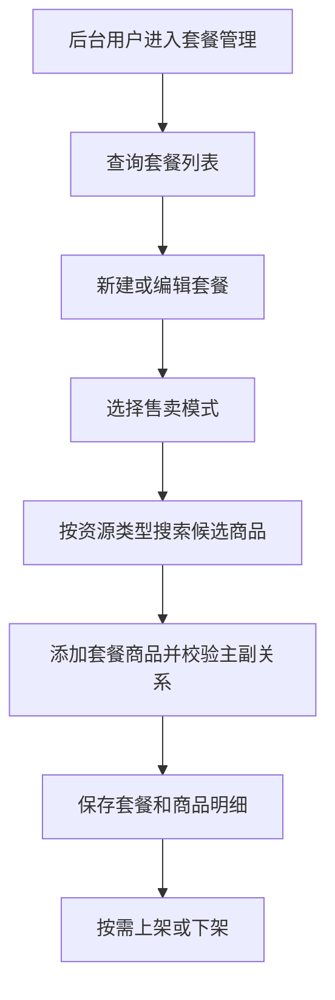

# Design: product-bundle-management

## 方案概览

在后台新增独立套餐模块，使用 `osh_product_bundle` 保存套餐主表，使用 `osh_bundle_item` 保存套餐内商品明细。后端提供 `/pc/admin/bundle/*` 管理接口，前端通过这些接口完成套餐列表、详情、保存、上下架、删除和资源搜索。资源搜索能力限定在套餐模块自己的 VO、Mapper 和 XML 中实现，避免影响兑换码等其他模块。

## 现状分析

- 相关模块：新增 `controller/bundle`、`service/bundle`、`mapper/bundle`、`domain/bundle`。
- 相关接口：新增 `/pc/admin/bundle/page`、`/detail`、`/save`、`/status`、`/delete`、`/resource/search`。
- 当前数据结构：新增 `osh_product_bundle`、`osh_bundle_item`。
- 当前配置：不新增 Nacos、Redis、Kafka、ES 配置。

## 详细设计

### 接口设计

| Method | Path | 变化 | 兼容策略 |
|---|---|---|---|
| POST | `/pc/admin/bundle/page` | 新增套餐分页查询 | 新接口，`@OshUserLevel(5)` |
| GET | `/pc/admin/bundle/detail` | 新增套餐详情查询 | 新接口，`@OshUserLevel(5)` |
| POST | `/pc/admin/bundle/save` | 新增创建/编辑套餐 | 新接口，`@OshUserLevel(5)` |
| POST | `/pc/admin/bundle/status` | 新增套餐上下架/草稿状态更新 | 新接口，`@OshUserLevel(5)` |
| POST | `/pc/admin/bundle/delete` | 新增套餐删除 | 新接口，`@OshUserLevel(5)` |
| POST | `/pc/admin/bundle/resource/search` | 新增套餐资源候选搜索 | 新接口，`@OshUserLevel(5)` |

### 数据设计

| 表/索引/缓存 | 变化 | 迁移方式 | 回滚方式 |
|---|---|---|---|
| `osh_product_bundle` | 新增套餐主表 | 执行 `sql/2026/07/product_bundle.sql` | 回滚代码后可保留，必要时备份后删除 |
| `osh_bundle_item` | 新增套餐商品明细表 | 执行 `sql/2026/07/product_bundle.sql` | 回滚代码后可保留，必要时备份后删除 |
| `uk_bundle_no` | 套餐编号唯一约束 | 随建表创建 | 随表删除 |
| `idx_bundle_status` | 套餐状态查询索引 | 随建表创建 | 随表删除 |
| `idx_bundle_item_bundle` | 套餐明细按套餐查询索引 | 随建表创建 | 随表删除 |
| `idx_bundle_item_resource` | 套餐明细按资源定位索引 | 随建表创建 | 随表删除 |

### 业务流程

### 中间件影响

- Redis：无。
- Kafka：无。
- Elasticsearch：无。
- Nacos：无。
- R2/S3：仅使用现有 `OssUtil` 将封面相对路径转换为完整临时地址，不新增存储写入。

## 兼容性

- 老接口是否保留：全部保留。
- 老数据是否可读：不涉及历史数据迁移。
- 前端是否需要同步：需要新增套餐管理页面和导航入口。
- 灰度期间新旧版本是否兼容：后端新增接口不影响旧前端；新前端需要后端发布后才能正常使用套餐管理。

## 测试计划

- 前端构建：`npm run generate`。
- 手动验收：使用管理员账号进入套餐管理，完成列表、搜索、新建、编辑、上下架、删除保护流程。
- 后端静态检查：`git diff --check`。
- 后端编译：当前 `backstage-system` 全量编译受既有非套餐模块注解/常量问题阻塞，套餐模块变更需结合用户手动验收和后续 CI 结果确认。

## 发布与回滚

- 发布步骤：执行 `sql/2026/07/product_bundle.sql`，发布后端，发布前端。
- 验证命令：访问套餐管理页面，调用 `/pc/admin/bundle/page` 和 `/pc/admin/bundle/resource/search`。
- 回滚步骤：回滚前后端代码；新增表可暂时保留，不影响现有业务。
