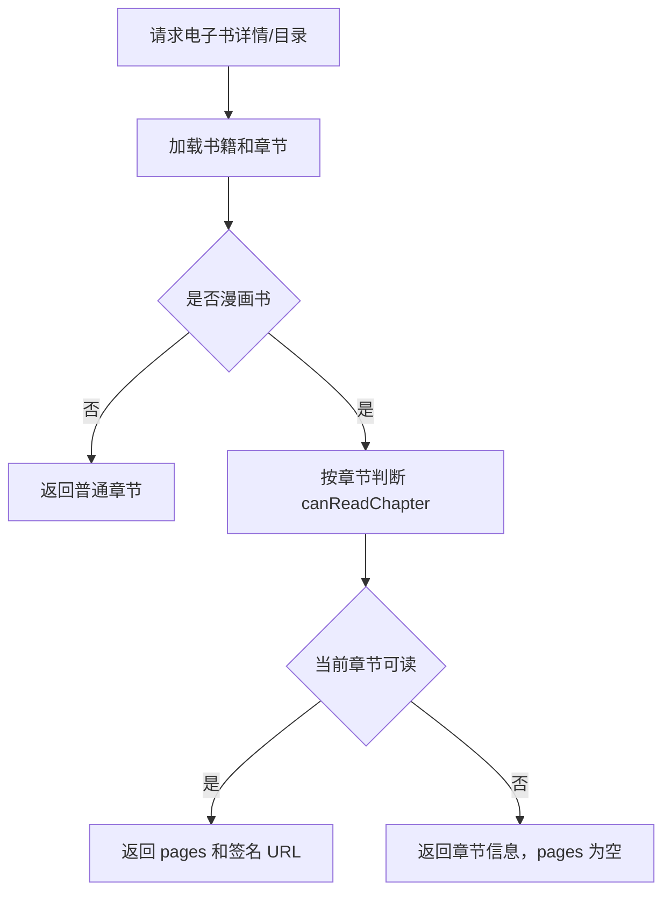

# Design: protect-book-comic-assets

## 方案概览

后端在组装漫画电子书详情和目录时，按当前用户对每个章节的可读权限过滤 `pages`。章节本身继续返回，方便前端展示目录；只有可读章节才返回漫画页图片。阅读接口 `/pc/book/detail` 保持已有章节级权限校验。

## 现状分析

- 相关模块：电子书、漫画章节页、对象存储签名 URL。
- 相关类/接口：
  - `BookController#getById`
  - `BookController#menus`
  - `BookServiceImpl#buildBookDetailVO`
  - `BookServiceImpl#selectBookMenu`
  - `BookServiceImpl#attachComicPages`
  - `BookServiceImpl#selectBookChapterContent`
- 当前数据结构：
  - `osh_book.level` 控制电子书访问等级。
  - `osh_book_chapter.is_free` 控制章节是否免费。
  - `osh_book_chapter_page.image_url` 保存漫画图片对象 key 或历史 URL。
  - `osh_user_book_relation.purchased` 标记购买状态。
- 当前配置：使用 R2/S3 签名 URL 访问对象。

## 详细设计

### 接口设计

| Method | Path | 变化 | 兼容策略 |
|---|---|---|---|
| GET | `/pc/book/getById` | 漫画书详情只给可读章节返回 `pages` | 章节目录字段保留，未授权章节 `pages=[]` |
| GET | `/pc/book/menus` | 漫画目录只给可读章节返回 `pages` | 菜单结构保留，未授权章节 `pages=[]` |
| GET | `/pc/book/detail` | 不改接口，继续使用章节级权限校验 | 已有阅读页不需要同步修改 |

### 数据设计

| 表/索引/缓存 | 变化 | 迁移方式 | 回滚方式 |
|---|---|---|---|
| 无 | 无 | 无 | 回滚代码 |

### 业务流程

### 中间件影响

- Redis：无。
- Kafka：无。
- Elasticsearch：无。
- Nacos：无。
- R2/S3：减少未授权场景下签名 URL 生成，不改 bucket 配置。

## 兼容性

- 老接口保留。
- 老数据可读。
- 前端详情页和阅读页不需要同步修改。
- 灰度期间新后端对旧前端兼容。

## 测试计划

- 集成测试：
  - 未购买用户详情不返回收费章节图片。
  - 免费章节图片仍返回。
  - 已购买用户详情返回图片。
  - 章节内容接口对未授权收费章节拒绝访问。
- 接口 smoke：
  - `curl /pc/book/getById?id=1008` 检查 `pages`。
  - 登录普通用户访问详情页和可试读章节。
- 回归范围：
  - 电子书详情页。
  - 漫画阅读页。
  - 电子书编辑页 `forEdit=true`。

## 发布与回滚

- 发布步骤：合并 feature 分支后走 QA 部署。
- 验证命令：`mvn -pl backstage-admin -Dtest=BookControllerApiTest test`
- 回滚步骤：回滚本次提交。
