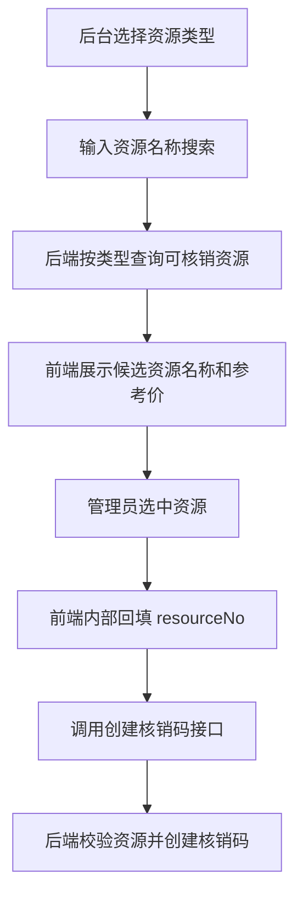

# Design: redeem-code-resource-search

## 方案概览

在核销模块新增资源搜索接口，按资源类型路由到对应业务表查询候选资源。前端选择资源后仅把内部 `resourceNo` 提交给创建核销码接口，后端继续通过 `resolveResource` 校验资源并复用现有订单、支付流水、权益发放逻辑。

## 现状分析

- 相关模块：`controller/redeem`、`service/redeem`、`mapper/redeem`
- 当前数据结构：`osh_redeem_code.resource_no` 保存资源编号快照，`product_type/product_id/product_name` 保存商品快照。
- 当前资源范围：课程、电子书、工具、会员套餐；专栏暂不处理。
- 用户痛点：资源编号不是后台日常操作字段，消费者也只知道核销码和资源名称。

## 详细设计

### 接口设计

| Method | Path | 变化 | 兼容策略 |
|---|---|---|---|
| POST | `/pc/admin/redeem/resource/search` | 新增按资源类型、名称搜索资源候选 | `@OshUserLevel(5)`，只影响后台核销码创建 |
| POST | `/pc/admin/redeem/code/create` | 保持 `resourceNo` 入参 | 前端由资源选择自动回填，不让用户手填 |

搜索入参：`resourceType/pageNum/pageSize/keyword`。

搜索出参：`resourceNo/resourceType/productType/productId/productName/price/originalPrice`。

### 数据设计

| 表/索引 | 变化 | 迁移方式 | 回滚方式 |
|---|---|---|---|
| `osh_course.idx_redeem_course_no` | 新增资源编号索引 | 追加到 `redeem_code.sql` | `DROP INDEX` |
| `osh_book.idx_redeem_book_no` | 新增资源编号索引 | 追加到 `redeem_code.sql` | `DROP INDEX` |
| `osh_book.idx_redeem_book_title` | 新增标题索引 | 追加到 `redeem_code.sql` | `DROP INDEX` |
| `osh_tool.idx_redeem_tool_no` | 新增资源编号索引 | 追加到 `redeem_code.sql` | `DROP INDEX` |
| `osh_member_plan.idx_redeem_member_plan_no` | 新增资源编号索引 | 追加到 `redeem_code.sql` | `DROP INDEX` |
| `osh_member_plan.idx_redeem_member_plan_name` | 新增套餐名称索引 | 追加到 `redeem_code.sql` | `DROP INDEX` |

### 业务流程

### 中间件影响

- Redis：无
- Kafka：无
- Elasticsearch：无
- Nacos：无
- R2/S3：无

## 兼容性

- 老接口保留：`resource/resolve` 保留，创建接口仍以 `resourceNo` 为内部契约。
- 老数据可读：历史核销码继续通过 `product_name/resource_type` 展示。
- 前端需要同步：后台创建页切换为资源搜索选择，用户中心隐藏资源编号。
- 灰度兼容：前端新版本调用新增接口；后端旧创建接口行为不变。

## 测试计划

- 后端构建：`mvn -pl backstage-admin -am -DskipTests package`
- 前端构建：`npm run generate`
- SQL smoke：确认 `idx_redeem_*` 索引存在。
- 接口 smoke：按课程、电子书、工具、会员套餐各搜索一次资源。

## 发布与回滚

- 发布步骤：执行 `redeem_code.sql`，发布后端，发布前端。
- 验证命令：检查资源搜索接口、后台创建核销码、用户中心核销码列表。
- 回滚步骤：回滚前后端代码；新增索引可保留，不影响业务。
