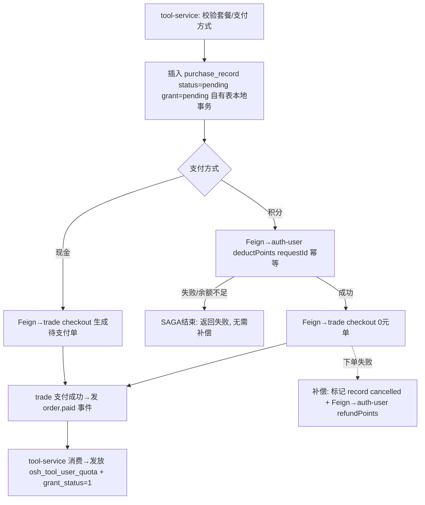

# Design: split-tool-service

## 方案概览

新建 `tool-service`（Spring Boot 3.2 + JDK 17，复用 Phase 0 的 gateway/observability），以绞杀者模式承接工具域：网关按 `/pc/tool/**` 灰度分流，`backstage-system` 工具代码双跑期保留不删。工具域自有 7 张表写权限归 tool-service（Phase 1 共库不共写，仍连同一 MySQL）。所有跨域"直写/直调"改造为显式契约：积分/订单/OSS/提问/公告/贡献经 OpenFeign 调用（Phase 1 目标为单体内暴露的内部 API，待对应域拆分后 Feign 目标平滑改指向新服务，契约不变）。原 `ToolPaidHandler` 对工具表的跨域写，改为 trade 侧发布"订单已支付"事件、tool-service 消费后发放点数配额，确保 `osh_tool_user_quota` 单一写者。点数购买用 Outbox 可靠消息 + SAGA 补偿替代原单一本地事务。

## 现状分析

- 相关模块：`backstage-system`（工具域 controller/service/mapper/domain 全量）、`backstage-framework`（`PaymentSuccessConsumer` Kafka 消费、Security、线程池）、`backstage-common`（`RedisCache`、`UserContextUtil`、`@DistributeLock`、`@OshUserLevel`、`@OshUserEvent`、`OshUserConstants`、`R`/`PageResponse`）。
- 相关类/接口：
  - Controller：`OshToolController`(/pc/tool)、`ToolPurchaseController`(/pc/tool/purchase)、`ToolAnnouncementController`(/pc/tool/announcement)。
  - Service：`IOshToolService`/`OshToolServiceImpl`、`ToolPurchaseService`/`ToolPurchaseServiceImpl`、`IOshToolCollectionService`、`IOshToolEsService`、`IToolAnnouncementService`、`ResourceNoGenerator`/`ResourceNoDuplicateChecker`、`ToolIndexMessage`/`ToolIndexDeleteMessage`/`ToolIndexEventType`。
  - Mapper：`OshToolMapper`、`OshToolPackageMapper`、`OshToolPurchaseRecordMapper`、`OshToolCollectionMapper`、`OshToolVoteMapper`、`OshToolTagMapper`、`OshToolQuotaMapper`、`OshToolAnnouncementMapper`、`OshToolEsMapper`。
  - 支付发放：`ToolPaidHandler`（位于 `service/order/handler/`，`bizType=TOOL`，注入 `OshToolQuotaMapper`+`OshToolPurchaseRecordMapper`）、`OrderPaidHandlerRegistry`、`PaymentSuccessConsumer`。
- 当前数据结构：工具域自有 7 表 + 跨域写 3 类表（见下）。ES 工具索引经 Outbox→Kafka topic `osh.tool.index`→Flink 同步。
- 当前配置：`SearchEsProperties`（ES 开关，失败降级 MySQL）、`UploadPathEnum.TOOL_COVER`、`CourseUploadConstants`（图片校验，注意其位于 course 常量但被 tool 复用）。

## 详细设计

### 增量范围（本 change = 核心 tool 子域）

| 子域 | 是否本次迁移 | 说明 |
|---|---|---|
| 工具内容/搜索/详情/浏览/推荐/标签（`/pc/tool` 大部分） | ✅ 本次 | 读多写少，风险最低，优先切流 |
| 工具收藏/点赞/差评/点数消耗/计算器 | ✅ 本次 | 自有表，含 `@DistributeLock` 写路径 |
| 点数套餐购买/记录/关单/套餐后台管理（`/pc/tool/purchase`） | ✅ 本次 | 含跨域积分+订单，SAGA 改造重点 |
| 工具公告查询（`/pc/tool/announcement`） | ✅ 本次（读） | 写 `osh_announcement` 归属见跨域表 |
| 工具后台增删改/背景图上传 | ✅ 本次 | `@OshUserLevel(5)`，含 OSS 跨域 |
| website 实用网站（`/pc/website` 等） | ⛔ 后续增量 | `OshPracticalWebsiteServiceImpl` 647 行，独立增量 |
| site 站点（`/pc/site`，含 SSH `RemoteShellExecutor`） | ⛔ 后续增量 | 基础设施敏感，独立评估 |
| feedback（实际在 `assistant`/`homepage` 包） | ⛔ 后续增量 | 需先做边界归位（当前不在 tool 包） |
| friend-link（实际在 `ad` 包 `/pc/site/friend-link`） | ⛔ 后续增量 | 需先做边界归位 |

> 边界归位说明：总纲将 website/site/feedback/friend-link 划入 tool-service 远期边界，但实际代码分散在 `website`/`site`/`assistant`/`homepage`/`ad` 包。为保持试点小而稳，本次仅迁核心 tool 子域；其余作为 tool-service 的后续增量，迁移前先在各子域 change 中确认归属。

### API 契约冻结清单（URL/参数/响应结构一律不变）

| Method | Path | 鉴权 | 变化 | 兼容策略 |
|---|---|---|---|---|
| POST | /pc/tool/search | @Anonymous | 迁移 | 网关分流，响应逐字段一致 |
| POST | /pc/tool/esSearch | @OshUserLevel(1) | 迁移 | 同上 |
| POST | /pc/tool/esSync/all | @Anonymous | 迁移 | 同上 |
| POST | /pc/tool/fill/no | @OshUserLevel(5) | 迁移 | 同上 |
| POST | /pc/tool/quota/init | (后台) | 迁移 | 同上 |
| GET | /pc/tool/quota/current | @Anonymous | 迁移 | 同上 |
| POST | /pc/tool/recommend | @Anonymous | 迁移 | 同上 |
| GET | /pc/tool/tags | @Anonymous | 迁移 | 同上 |
| GET | /pc/tool/tags/recommend | @Anonymous | 迁移 | 同上 |
| GET | /pc/tool/detail/{id} | @Anonymous | 迁移 | 同上 |
| POST | /pc/tool/view/{id} | @Anonymous | 迁移 | 同上 |
| POST | /pc/tool/save | @OshUserLevel(5) | 迁移 | 同上 |
| POST | /pc/tool/update | @OshUserLevel(5)+@DistributeLock(resource) | 迁移 | 锁 key 冻结 |
| POST | /pc/tool/background/upload | @OshUserLevel(5) | 迁移 | OSS 经 Feign |
| POST | /pc/tool/delete | @OshUserLevel(5)+@DistributeLock(tool:delete) | 迁移 | 锁 key 冻结 |
| POST | /pc/tool/collection/add | @OshUserLevel(1) | 迁移 | 计数一致性保留 |
| POST | /pc/tool/collection/remove | @OshUserLevel(1) | 迁移 | 同上 |
| POST | /pc/tool/use/consume | @OshUserLevel(1) | 迁移 | CAS 闸门 `remaining_count>=quotaCost` 保留 |
| POST | /pc/tool/calculator/calculate | @OshUserLevel(1) | 迁移 | 修复 calculateTool 事务缺失（见测试计划） |
| POST | /pc/tool/question/create | @OshUserLevel(1) | 迁移 | 提问经 Feign→course |
| POST | /pc/tool/use/check | @OshUserLevel(1) | 迁移 | TOCTOU 语义保留（consume 端 CAS 兜底） |
| POST | /pc/tool/vote/good | @OshUserLevel(1) | 迁移 | 计数一致性保留 |
| POST | /pc/tool/vote/bad | @OshUserLevel(1) | 迁移 | 同上 |
| GET | /pc/tool/purchase/detail | @Anonymous | 迁移 | 剩余点数经 Feign→auth-user |
| GET | /pc/tool/purchase/packages | @Anonymous | 迁移 | 自有表 |
| POST | /pc/tool/purchase/create | @OshUserLevel(1) | 迁移 | SAGA 改造（积分+订单） |
| POST | /pc/tool/purchase/list | @OshUserLevel(1) | 迁移 | 自有表分页 |
| POST | /pc/tool/purchase/cancel | @OshUserLevel(1) | 迁移 | 关单经 Feign→trade；积分退还 SAGA 补偿 |
| POST | /pc/tool/purchase/package/save | @OshUserLevel(5) | 迁移 | 自有表 |
| POST | /pc/tool/purchase/package/delete | @OshUserLevel(5) | 迁移 | 软删自有表 |
| GET | /pc/tool/announcement/notice | @Anonymous | 迁移 | 读 osh_announcement（见跨域表） |
| GET | /pc/tool/announcement/dynamic | @Anonymous | 迁移 | 同上 |
| GET | /pc/tool/announcement/systemNotice/latest | @Anonymous | 迁移 | 同上 |
| GET | /pc/tool/announcement/userNotice/latest | @Anonymous | 迁移 | 同上 |

- 响应封装统一沿用 `R<T>` / `PageResponse<T>`（与单体一致），错误码/文案不变。
- 上述端点在 tool-service 侧路径、入参 DTO（`ToolSearchRequest`/`ToolPurchaseCreateRequest` 等）、返回 VO（`ToolPurchaseDetailVO`/`ToolQuotaPackageVO`/`ToolPurchaseListVO`/`ToolCalculatorResultVO`/`ToolUsagePermission` 等）字段结构冻结。

### 数据库写权限归属

| 表 | 归属服务 | tool-service 权限 | 迁移方式 | 回滚方式 |
|---|---|---|---|---|
| osh_tool | tool-service | 读写 | 共库切写归属 | 网关指回单体 |
| osh_tool_package | tool-service | 读写 | 同上 | 同上 |
| osh_tool_package_purchase_record | tool-service | 读写 | 同上 | 同上 |
| osh_tool_collection | tool-service | 读写 | 同上 | 同上 |
| osh_tool_vote | tool-service | 读写 | 同上 | 同上 |
| osh_tool_tag | tool-service | 读写 | 同上 | 同上 |
| osh_tool_user_quota | tool-service | 读写（单一写者） | 同上；发放改由 tool-service 消费事件执行 | 同上 |
| osh_user_asset / osh_user_asset_record | auth-user-service | 只读经 Feign，禁止直写 | 积分扣减/退还改 Feign 契约 | Feign 目标回退单体 |
| osh_announcement | content-service | 只读经 Feign/事件；工具公告写入改事件 | 见事件清单 | 同上 |
| osh_resource_contribution / osh_resource_revenue_record | auth-user-service(behavior) | 经 Feign/事件，禁止直写 | 贡献记录改 Feign 契约 | 同上 |
| osh_order / osh_payment | trade-service | 经 Feign，禁止直写 | 下单/关单改 Feign 契约 | 同上 |

> 一表一主：tool-service 只对上表前 7 张自有表有写权限；对其余域的表一律经 Feign 契约或事件，不得直连 Mapper。共库期物理上仍可连，但代码层面移除跨域 Mapper 注入。

### 跨域依赖改造（拆分核心）

| 现状直连 | 归属 | Phase 1 机制（目标=单体内部 API） | 目标态机制 | 契约 |
|---|---|---|---|---|
| `OshUserAssetMapper.selectByUserIdForUpdate` + 扣/退积分写 asset/record | auth-user | Feign 调单体 `/internal/user/asset/points/deduct`、`/refund` | Feign 改指 auth-user-service | `auth-user-api`：deductPoints/refundPoints(userId, amount, requestId) 幂等 |
| 刷新 LoginUser 缓存 POINTS（`refreshUserAssetCache`） | auth-user | 由 auth-user 侧在扣/退成功后自行刷新；tool 不再写该缓存 | 同左 | 契约内含缓存刷新责任转移 |
| `OrderCheckoutService.checkout()` | trade | Feign 调单体 `/internal/order/checkout` | Feign 改指 trade-service | `trade-api`：checkout(OrderCheckoutReqVO)→OrderCheckoutRespVO |
| `OrderService.cancelPaymentByOrderNo()` | trade | Feign 调单体 `/internal/order/cancel` | 同左 | `trade-api`：cancelByOrderNo(orderNo) |
| `ToolPaidHandler` 发放点数（写 tool 表，但由 order 侧触发） | trade 触发 / tool 落库 | trade 侧发布 `osh.trade.order.paid.v1`(productType=TOOL) → tool-service 消费发放 | 同左（trade-service 发布） | 事件信封 + tool-service 消费者 |
| `IOshQAQuestionService.addToolQuestion()` | course | Feign 调单体 `/internal/qa/tool-question` | Feign 改指 course-service | `course-api`：addToolQuestion(userId, toolId, content, tags) |
| `OssService.upload()/getLimitedUrl()` | platform | Feign 调单体 `/internal/oss/upload`、`/sign` | Feign 改指 platform-service | `platform-api`：upload/getLimitedUrl；DB 只存 objectKey |
| `ContributionService.recordContribution/recordRevenue` | auth-user(behavior) | Feign/事件（异步，非核心，可 Outbox） | 同左 | 事件 `osh.tool.resource.contribution.v1` |
| `@OshUserEvent` 行为埋点 | auth-user(behavior) | 切面改为发布行为事件（异步，失败不阻断主流程） | 同左 | 事件 `osh.user.behavior.v1` |
| `@OshUserLevel` / `UserContextUtil` 用户上下文 | auth-user | 网关透传 X-User-Id/X-User-Level/X-User-Key，服务内还原 | 同左 | 网关契约（add-gateway-service） |

### 支付成功发放点数配额的归属迁移（单一写者）

```mermaid
sequenceDiagram
  participant Pay as PayNotifyController(单体/trade)
  participant MQ as Kafka
  participant Consumer as PaymentSuccessConsumer(单体/trade)
  participant Tool as tool-service 消费者
  participant DB as osh_tool_user_quota / purchase_record
  Pay->>MQ: 支付回调
  MQ->>Consumer: 消费(重试保障)
  Consumer->>Consumer: 按 productType 路由; TOOL 不再本地写工具表
  Consumer->>MQ: 发布 osh.trade.order.paid.v1(productType=TOOL, orderNo)
  MQ->>Tool: tool-service 消费订单已支付事件
  Tool->>DB: grantStatus CAS 幂等短路; increaseUserQuota(fallback insertUserQuota)
  Tool->>DB: 置 purchase_record.grant_status=1
```

- 关键点：`osh_tool_user_quota` 的写者唯一为 tool-service，无论购买页由单体还是 tool-service 服务（灰度无关），发放都经事件由 tool-service 执行，避免双写者竞态。
- 幂等：沿用 `ToolPaidHandler` 既有 `FOR UPDATE + grantStatus 幂等短路 + increaseUserQuota/insertUserQuota` 语义，消费端重复投递被 grant_status CAS 拦截。
- 单体侧改动（必要的最小改动）：`ToolPaidHandler.handle` 从"直接写工具表"改为"发布 order.paid 事件"，发放逻辑迁至 tool-service 消费者。此为解开一表一主所必需，双跑期该 handler 行为变更需在 spec 覆盖。

### 事件清单

| 事件 | topic | 方向 | 触发 | 消费方 | 幂等键 |
|---|---|---|---|---|---|
| TOOL_INDEX_CREATE/UPDATE/DELETE/COUNTER | osh.tool.index | tool→出 | 工具增删改/计数变更（Outbox TOOL 聚合） | Flink→ES | eventId |
| 订单已支付(TOOL) | osh.trade.order.paid.v1 | 入(trade→tool) | 支付回调路由 TOOL | tool-service 发放点数 | orderNo+grant_status |
| 工具资源贡献 | osh.tool.resource.contribution.v1 | tool→出 | 内部用户创建/购买工具 | auth-user(behavior) | eventId |
| 用户行为埋点 | osh.user.behavior.v1 | tool→出 | @OshUserEvent 切面 | auth-user(behavior) | eventId |
| 工具公告写入 | osh.content.announcement.v1 | tool→出 | 工具审核通过/购买成功需公告时 | content-service 写 osh_announcement + WS 刷新 | eventId |

- 所有出向事件经 `osh_outbox_event`（TOOL 聚合已注册）本地事务登记 + 提交后发布 + Quartz 兜底重试；入向消费端 CAS 幂等。
- topic 名 `osh.tool.index` 冻结（Flink 依赖）；新事件遵循 `osh.{service}.{aggregate}.v1`。

### 点数购买 SAGA（替代原单一本地事务）



- 补偿复用现有 `cancelPendingPurchase`（关单/超时触发退还积分）语义，改为经 Feign 调 auth-user refundPoints。
- 写操作严禁自动重试；deductPoints/refundPoints/checkout 均以 requestId/orderNo 幂等。
- 发放为异步最终一致：purchase_record.grant_status 作为发放闸门，消费端 CAS 保证只发放一次。

### 用户上下文与鉴权透传

- 网关校验 JWT 后注入 `X-User-Id`/`X-User-Key`/`X-User-Level`，tool-service 侧 `UserContextUtil` 从请求头还原（替代原从单体 ThreadLocal/SecurityContext 获取）。
- `@OshUserLevel(1/5)`、`@Anonymous`、`@PreAuthorize` 语义与权限字符串冻结；后台管理端点(5 级)分流后必须仍鉴权。
- `@OshUserEvent` 切面在 tool-service 内改为异步发布行为事件，失败不阻断主流程。
- `@DistributeLock(scene="resource"/"tool:delete", key="operation")` 锁 key 字面量冻结（抽到共享模块），确保与单体双跑期互斥，防并发改同一工具。

### 缓存与锁

- Redis：LoginUser 缓存 key（`OshUserConstants.LOGIN_USER+userId`）冻结；积分 POINTS 缓存刷新责任移交 auth-user（tool 不再写）。
- 工具点数缓存/计数如存在，key 冻结；`consumeUserQuota` 的 DB CAS 闸门 `WHERE remaining_count>=#{quotaCost} AND delete_flag=0` 原样保留（物理防透支）。

### 灰度发布与回滚

- 灰度维度：按用户 ID 尾号，`/pc/tool/**` 只读内容链路先行（1%→10%→50%→100%），购买/后台写链路最后提升并压测。
- 双跑：单体工具代码保留，网关可随时将 `/pc/tool/**` 指回单体（路由级秒级回滚）。
- 数据：共库且无结构变更，回滚无损；`osh_tool_user_quota` 单一写者保证回滚不产生双写冲突。

## 兼容性

| 维度 | 结论 |
|---|---|
| 老接口是否保留 | 是，URL/参数/响应结构冻结；单体代码双跑期保留 |
| 老数据是否可读 | 是，共库不迁数据 |
| 前端是否需要同步 | 否，分流由网关控制 |
| 灰度期新旧兼容 | 兼容；四类契约冻结（URL/权限串/锁 key/LoginUser key）+ 事件信封统一 + quota 单一写者 |
| ES/Flink | topic `osh.tool.index` 与事件语义不变，Flink 索引同步不受影响 |
| 支付链路 | 回调仍落单体/trade，经事件驱动 tool 发放；grant_status 幂等 |

## 测试计划

- 单元测试（迁移并补齐）：`ToolPurchaseServiceImpl` 的 SAGA 分支（积分扣减成功/失败/补偿退还）、`ToolPaidHandler` 逻辑迁至 tool-service 消费者后的 grantStatus 幂等、`consumeUserQuota` CAS 闸门。
- 缺陷回归（迁移即修，来自已知审查）：
  - `OshToolServiceImpl.calculateTool` 缺 `@Transactional`（点数已扣但计算异常未回滚）→ 迁移时补事务。
  - `calculateTool` 的 `increaseTotalUsage`+`saveToolIndexEvent` 非原子 → 纳入同一事务/Outbox。
  - `/use/check` 与 `/use/consume` 的 TOCTOU 窗口 → consume 端 CAS 兜底，前端处理"check 通过但 consume 失败"。
- 集成测试：tool-service + Feign 回调单体（asset/order/oss/qa）+ Kafka 事件消费发放全链路。
- 接口 smoke（新老双路径对比）：契约冻结清单全部端点，经 tool-service 与经单体响应逐字段一致。
- 契约测试：`auth-user-api`/`trade-api`/`course-api`/`platform-api` 用到的接口 stub 校验。
- 越权测试：`@OshUserLevel(5)` 端点分流后未授权用户被拦截。
- 回滚演练：灰度中将 `/pc/tool/**` 指回单体，验证流量秒级回退且数据一致。

## 发布与回滚

- 发布步骤：
  1. 单体侧暴露 `/internal/**` 契约 API（asset/order/oss/qa）+ 将 `ToolPaidHandler` 改为发布 order.paid 事件（配套 spec）。
  2. 部署 tool-service，注册 Nacos，接入可观测性；灰度比例 0（不接流量）自测。
  3. 网关配置 `/pc/tool/**` 路由 + 灰度规则；从只读内容链路 1% 起灰度。
  4. 逐档提升灰度，购买/后台写链路最后；每档观察错误率/P99/发放一致性。
  5. 全量后进入双跑观察期，单体工具代码冻结维护，期满后再评估删除。
- 验证命令：新老双路径 `curl` 对比核心端点；`osh_tool_user_quota` 发放对账（购买记录 grant_status 与配额增量一致）；Kafka `osh.tool.index` 与 `osh.trade.order.paid.v1` 消费 lag 监控。
- 回滚步骤：路由级——网关将 `/pc/tool/**` 指回单体（秒级）；事件级——若发放异常，暂停 tool-service 消费、单体 ToolPaidHandler 临时恢复本地发放（预案开关）；因共库无结构变更，回滚无损。
