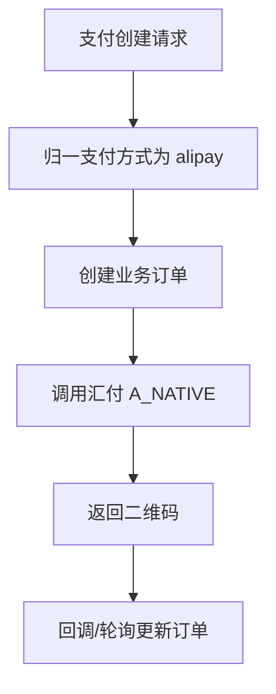

# Design: unify-alipay-payment-only

## 方案概览

后端新增统一归一口径：新建支付只接受并生成支付宝支付。前端传入的空值、`wechat`、`wxpay`、`union` 等旧值不再触发对应未开通通道，而是归一为 `alipay`，汇付交易类型固定使用 `A_NATIVE`。历史订单字段不批量迁移，查询和回调继续兼容。

## 现状分析

- 相关模块：课程/套餐支付、公共订单支付、工具额度支付、拼团支付。
- 相关类/接口：`CourseBundlePayCheckoutService`、`ProductBundleServiceImpl`、`PayServiceImpl`、订单支付相关 Service。
- 当前数据结构：支付订单中可能保留历史支付方式字段。
- 当前配置：汇付商户配置已在环境侧配置，不进入 Git。

## 详细设计

### 接口设计

| Method | Path | 变化 | 兼容策略 |
|---|---|---|---|
| POST | `/pc/course/pay/create` | 新支付归一支付宝 | 旧参数兜底 |
| POST | `/pc/bundle/pay/create` | 新支付归一支付宝 | 旧参数兜底 |
| POST | 公共支付创建接口 | 新支付归一支付宝 | 旧参数兜底 |

### 数据设计

| 表/索引/缓存 | 变化 | 迁移方式 | 回滚方式 |
|---|---|---|---|
| 支付订单表 | 不改结构 | 无需迁移 | 回滚代码 |

### 业务流程

### 中间件影响

- Redis：无。
- Kafka：沿用现有支付成功事件。
- Elasticsearch：无。
- Nacos：不新增配置。
- R2/S3：无。

## 兼容性

- 老接口是否保留：保留。
- 老数据是否可读：可读。
- 前端是否需要同步：本 change 同步前端。
- 灰度期间新旧版本是否兼容：兼容；旧前端传微信也不会再走未开通微信通道。

## 测试计划

- 单元测试：支付方式归一、汇付交易类型映射。
- 集成测试：课程支付宝二维码生成、支付回调状态更新。
- 接口 smoke：测试环境课程/套餐支付。
- 回归范围：支付下单、状态查询、回调、权益发放。

## 发布与回滚

- 发布步骤：合并 QA，部署测试环境后验证。
- 验证命令：`mvn -pl backstage-admin -am -DskipTests package`。
- 回滚步骤：回滚该后端 PR。
